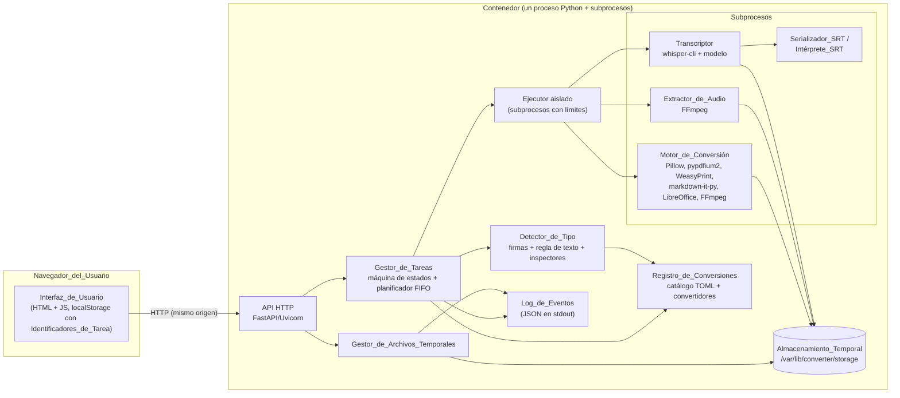
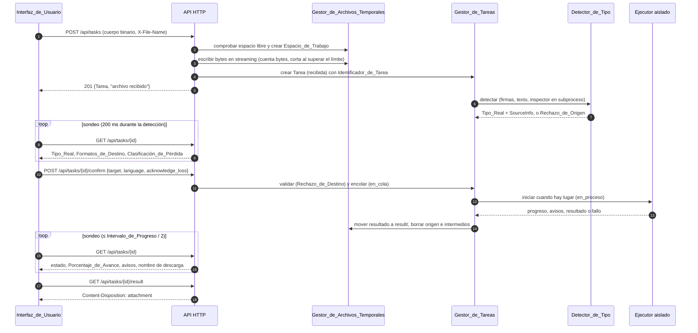
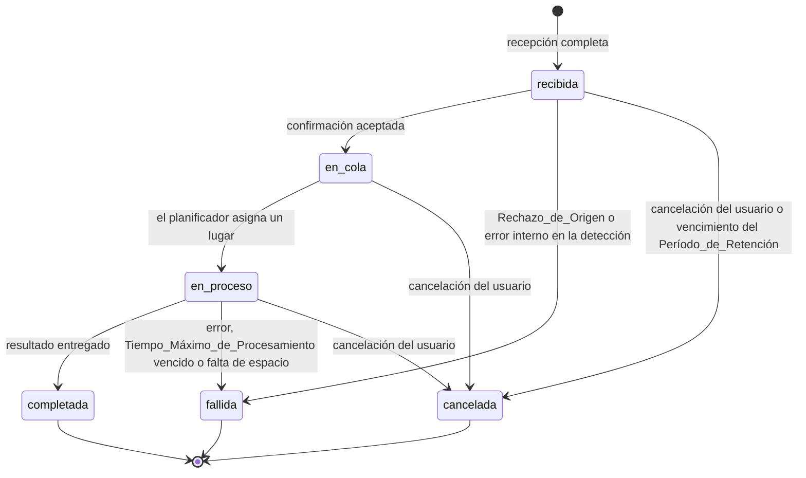
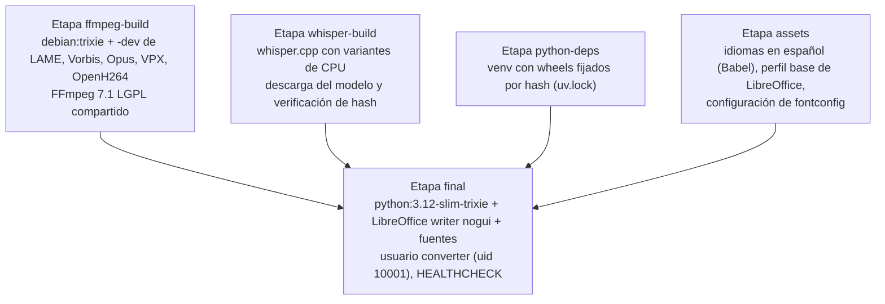
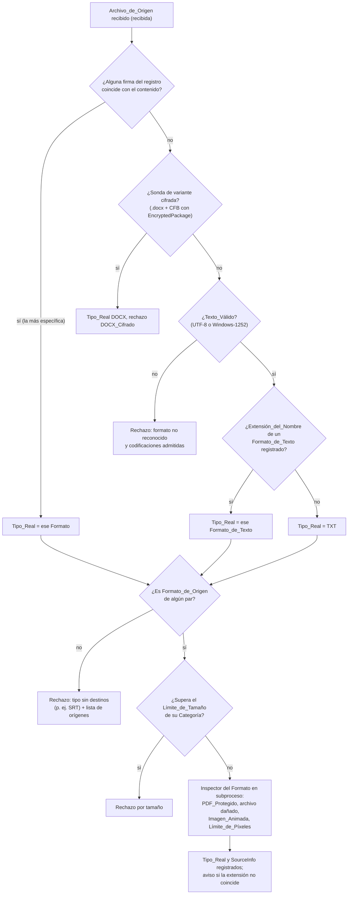
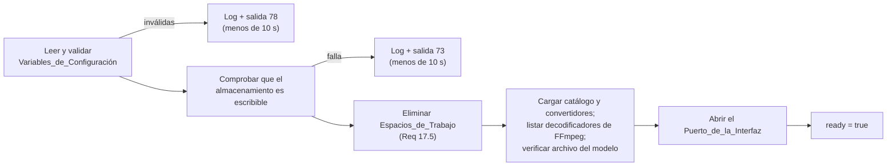
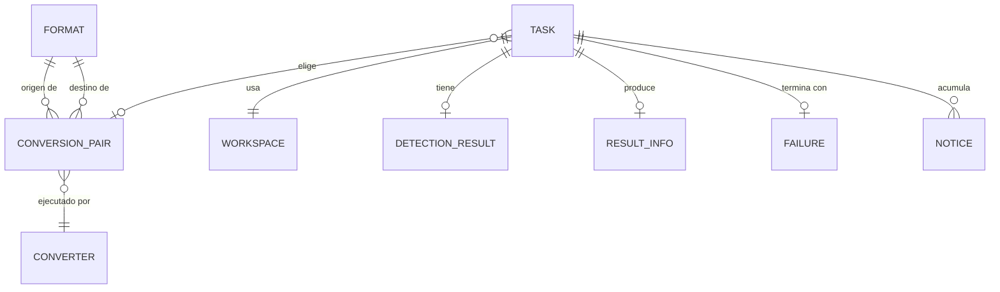

# Documento de Diseño: file-converter

## Overview

El Conversor es una aplicación web en español que recibe un archivo, detecta su Tipo_Real, ofrece los Formatos_de_Destino registrados para ese tipo, ejecuta la conversión o la transcripción elegida y entrega el Archivo_Resultado para descargar. Se distribuye como una única Imagen_de_Contenedor multiarquitectura (amd64 y arm64), funciona sin Internet, no tiene cuentas y admite uso simultáneo.

Este documento describe cómo se construye el sistema que especifica `requirements.md`. Las referencias "Req X.Y" remiten al criterio Y del Requisito X de ese documento.

### Objetivos del diseño

- Cubrir los 36 Pares_de_Conversión del Mapa_de_Conversión_Inicial con herramientas deterministas y licencias permisivas cuando existe una alternativa equivalente (S11, D8).
- Mantener el núcleo (Detector_de_Tipo, Gestor_de_Tareas, Gestor_de_Archivos_Temporales, Interfaz_de_Usuario) independiente de los pares concretos, para que agregar un par o un Formato sea un cambio de catálogo más un convertidor nuevo (Req 4.3, 4.4).
- Tratar todo archivo recibido como hostil: procesarlo en subprocesos aislados, con límites de recursos, sin red y sin seguir referencias externas.
- Mantener un solo proceso de aplicación y un solo contenedor, con estado en memoria (D14).

### Fuera del diseño

El diseño no agrega funciones fuera del alcance de los requisitos (OCR, lotes, edición, cuentas, persistencia de Tareas). Tampoco resuelve el control de acceso de red a la Interfaz_de_Usuario (S9).

### Decisiones principales

| Tema | Decisión | Motivo principal |
|---|---|---|
| Lenguaje del backend | Python 3.12 | Las bibliotecas de documentos e imágenes con licencia permisiva (Pillow, pypdfium2, WeasyPrint, markdown-it-py) son de Python. |
| Framework HTTP | FastAPI sobre Starlette y Uvicorn, un solo proceso asyncio | Permite recibir el cuerpo de la subida en streaming y orquestar subprocesos sin hilos adicionales. |
| Frontend | HTML, CSS y JavaScript sin dependencias ni paso de build, servidos por el mismo contenedor | No requiere CDN ni Internet (Req 18.15) y funciona en los cuatro navegadores (Req 18.2). |
| Actualización de estado | Sondeo (polling) por Tarea, con frecuencia adaptativa | Cada solicitud lleva un único Identificador_de_Tarea, lo que simplifica el aislamiento (Req 19.5, 19.6) y evita el límite de 6 conexiones por origen de HTTP/1.1 que afecta a SSE o long-polling con muchas Tareas. |
| Cola | En memoria, FIFO única, con Límite_de_Concurrencia | Las Tareas no persisten (D14). |
| Ejecución de conversiones | Siempre en subprocesos (herramientas externas o `python -m converter.workers.*`) con grupo de procesos propio, límites de recursos, entorno mínimo y timeout | Aísla fallos y vulnerabilidades de los parsers, y permite cancelar con SIGTERM/SIGKILL (Req 14.6, 14.7). |
| Catálogo | Archivos TOML de Formatos y Pares_de_Conversión, más convertidores registrados por identificador | Agregar un par no toca el núcleo (Req 4.3). |
| Transcripción | whisper.cpp con el modelo Whisper "small" multilingüe cuantizado a 8 bits (`ggml-small-q8_0.bin`) | Licencia MIT, CPU amd64/arm64, 252 MiB en disco y consumo estimado por debajo de 1 GB (S10). |
| Audio y video | FFmpeg 7.1 compilado sin `--enable-gpl` ni `--enable-nonfree`, con LAME, Vorbis, Opus, VP9 (libvpx) y H.264 (OpenH264) | Evita x264 (GPL) y mantiene FFmpeg en LGPL-2.1. |
| Orientación EXIF (D15) | Se aplica a los píxeles y el resultado no lleva la etiqueta. En imagen a PDF, un JPEG con orientación normal se inserta sin recodificar; con otra orientación se decodifica, se orienta y se guarda sin pérdida (Flate) | Cumple Req 5.4 y 5.10 y mantiene la clasificación Sin_Pérdida. |
| Video con dimensiones impares a MP4 (D16) | Filtro `pad` de FFmpeg que agrega 1 píxel negro a la derecha o abajo, solo en WEBM a MP4, con aviso al usuario | H.264 en 4:2:0 exige ancho y alto pares (Req 10.11). |
| Almacenamiento_Temporal en volúmenes (D17) | El Conversor no detecta ni rechaza sistemas de archivos de red; el volumen es responsabilidad de quien lo monta | S12; Req 13.2, 13.6 y 20.8. |
| Límites internos (D18) | Límites_de_Descompresión fijos en DOCX como Rechazo_de_Origen; Límite_de_Píxeles por página en PDF a PNG como fallo durante el procesamiento | Req 7.7 y 8.11. |
| Patentes de H.264 y AAC (D19) | Riesgo registrado en la sección de licencias; se evalúa solo si se decide distribuir el Conversor | S14. |

## Architecture

### Vista de componentes



El proceso principal no decodifica contenido de los archivos recibidos. Solo lee los primeros bytes para comparar firmas, hace la clasificación de texto en streaming y orquesta subprocesos. Todo análisis profundo (dimensiones, cuadros de animación, cifrado de PDF, pistas de video) y toda conversión ocurren en subprocesos que el Ejecutor aislado lanza con límites de tiempo, memoria y archivos abiertos.

### Modelo de procesos y concurrencia

- **Un proceso de aplicación.** Uvicorn ejecuta la aplicación FastAPI con un único worker y un único bucle asyncio. El estado de las Tareas vive en memoria en ese proceso; no hay base de datos ni cola externa (D14).
- **Subprocesos por paso.** Cada paso de procesamiento (inspección del detector, conversión, extracción de audio, transcripción) es un subproceso lanzado con `asyncio.create_subprocess_exec` a través de un lanzador (`python -m converter.sandbox.launch`) que fija límites con `setrlimit` y luego hace `exec` del programa real. El subproceso inicia su propio grupo de procesos (`start_new_session=True`) para que la cancelación alcance a sus hijos (por ejemplo, `soffice.bin`).
- **Dos grupos de capacidad.** El planificador limita las Tareas en_proceso al Límite_de_Concurrencia (Req 14.4). La detección usa un semáforo separado (4 inspecciones simultáneas), de modo que la detección y la oferta de destinos no esperan a que terminen Tareas en_proceso (Req 19.10).
- **Hilos.** No hay hilos de trabajo propios. Las operaciones de archivo bloqueantes del proceso principal (escritura de la subida, borrado de Espacios_de_Trabajo) usan `anyio.to_thread` con un límite pequeño.
- **Cantidad de hilos de las herramientas.** Al iniciar, el Conversor calcula las CPU efectivas leyendo la cuota de cgroup (`/sys/fs/cgroup/cpu.max`) y la afinidad del proceso. Con ese valor fija, para todo el ciclo de vida del Contenedor, los hilos de FFmpeg, OpenH264, libvpx y whisper.cpp. Un valor fijo hace reproducible el resultado en el mismo Equipo_de_Ejecución (Req 11.8, 13.4).

### Flujo de una Tarea



### Máquina de estados de la Tarea



La función de transición es pura y es la única forma de cambiar `Task.state` (Req 14.3). Un evento sobre una Tarea en Estado_Terminal no cambia el estado (Req 14.9). Un Rechazo_de_Destino no es una transición: la Tarea sigue en recibida (Req 16.12).

### Elección tecnológica

Los tamaños son aproximados, sin comprimir, e incluyen las dependencias de sistema de cada componente. Se confirman al construir la imagen y quedan en el Inventario_de_Licencias.

| Función | Elección | Licencia | arm64 | Tamaño | Alternativas evaluadas |
|---|---|---|---|---|---|
| Base de la imagen | `python:3.12-slim-trixie` (Debian 13) | PSF-2.0; paquetes Debian con licencias diversas | Sí | ~125 MB | Alpine (musl complica wheels de Pillow y pypdfium2 y LibreOffice); Debian 12 (oldstable, OpenH264 2.3). |
| HTTP | FastAPI, Starlette, Uvicorn (h11) | MIT, BSD-3, BSD-3 | Sí (Python puro) | ~15 MB | Flask (WSGI, sin streaming asíncrono simple); aiohttp (Apache-2.0, viable, menos validación declarativa). |
| Imágenes | Pillow 11 | MIT-CMU (HPND) | Wheels manylinux aarch64 | ~15 MB | ImageMagick (licencia propia permisiva, pero superficie de ataque amplia y políticas de seguridad delicadas); pyvips/libvips (LGPL-2.1). |
| PNG de 16 bits | pypng | MIT | Python puro | <1 MB | OpenCV (Apache-2.0, ~60 MB solo para esto). Pillow reduce a 8 bits los PNG RGB de 16 bits al abrirlos. |
| Imagen a PDF | Escritor propio `pdf_image_writer` | Propio | — | — | img2pdf (LGPL-3.0); Pillow (recodifica el JPEG y lo degrada, incompatible con Sin_Pérdida). |
| PDF: texto y rasterizado | pypdfium2 (PDFium) | Apache-2.0 o BSD-3; PDFium BSD-3 | Wheels aarch64 | ~10 MB | PyMuPDF (AGPL-3.0); Poppler/pdftotext (GPL-2.0); pdfminer.six (MIT, solo texto y lento). |
| Markdown a HTML | markdown-it-py, preset `commonmark` | MIT | Python puro | <1 MB | Pandoc (GPL-2.0); Python-Markdown (no sigue CommonMark estricto); cmarkgfm (MIT, viable, extensión C). |
| Análisis de HTML | BeautifulSoup4 con html5lib | MIT, MIT | Python puro | ~2 MB | lxml.html (no implementa el algoritmo de árbol de HTML5); html.parser (tolerante pero no estándar). |
| HTML a Markdown | markdownify con una subclase propia | MIT | Python puro | <1 MB | html2text (GPL-3.0); Pandoc (GPL-2.0). |
| HTML, MD y TXT a PDF | WeasyPrint (Pango, HarfBuzz, fontTools, pydyf) | BSD-3; Pango LGPL-2.1 enlazado dinámicamente; HarfBuzz MIT | Sí | ~45 MB | wkhtmltopdf (LGPL, sin mantenimiento, WebKit antiguo); Chromium headless (BSD, ~300 MB y motor JavaScript). |
| DOCX a PDF | LibreOffice 25.2 headless (`libreoffice-writer-nogui`) | MPL-2.0 | Sí (Debian) | ~350 MB | Pandoc con LaTeX (GPL y baja fidelidad); docx2pdf (requiere Microsoft Word). |
| XML de DOCX | lxml | BSD-3 (libxml2 MIT) | Wheels aarch64 | ~10 MB | ElementTree (sin protección configurable contra entidades). |
| DOCX cifrado | olefile | BSD-2 | Python puro | <1 MB | msoffcrypto-tool (MIT, descifra; no se necesita). |
| Fuentes | DejaVu (Fuente_Predeterminada); Liberation, Carlito y Caladea para DOCX | DejaVu: licencia Bitstream Vera y dominio público; Liberation y Carlito: OFL-1.1; Caladea: la que declare el paquete (OFL-1.1 o Apache-2.0) | — | ~25 MB | Noto completa (OFL-1.1, >500 MB con CJK). |
| Cobertura de glifos | fontTools | MIT | Python puro | Ya es dependencia de WeasyPrint | — |
| Audio y video | FFmpeg 7.1 compilado con `--disable-gpl --disable-nonfree --disable-network --disable-autodetect --enable-shared` | LGPL-2.1+ | Sí | ~40 MB con bibliotecas | FFmpeg de Debian (compilado con `--enable-gpl`, incluye x264/x265); GStreamer (LGPL, más piezas). |
| Códecs de salida | libmp3lame (MP3), libvorbis (OGG), libopus (audio WEBM), libvpx (VP9), libopenh264 (H.264), AAC nativo de FFmpeg | LGPL-2.0+, BSD-3, BSD-3, BSD-3, BSD-2, LGPL-2.1+ | Sí (paquetes Debian) | ~10 MB | x264 (GPL-2.0); fdk-aac (licencia no libre para FFmpeg). |
| Transcripción | whisper.cpp 1.8 (`whisper-cli`), compilado con `GGML_NATIVE=OFF`, `GGML_BACKEND_DL=ON`, `GGML_CPU_ALL_VARIANTS=ON` | MIT | Sí (NEON; variantes por CPU elegidas al ejecutar) | ~20 MB | Vosk (Apache-2.0; modelos por idioma, sin un modelo multilingüe único de tamaño intermedio); faster-whisper (MIT; CTranslate2 agrega ~200 MB y otro runtime); CMU Sphinx (BSD, precisión baja). |
| Modelo_de_Transcripción | `ggml-small-q8_0.bin` (Whisper small multilingüe, cuantizado Q8_0) | MIT | — | 252 MiB | `small` f16 (466 MiB, ~852 MB de RAM); `medium-q5_0` (514 MiB, probablemente más lento que tiempo real en 4 núcleos); `large-v3-turbo-q5_0` (547 MiB, más preciso; candidato si el benchmark lo permite). |
| Nombres de idiomas en español | Babel (CLDR), solo durante el build | BSD-3; datos CLDR con licencia Unicode | — | 0 en ejecución (genera un JSON) | Lista escrita a mano (propensa a errores). |
| Pruebas de propiedades | Hypothesis (solo en pruebas) | MPL-2.0 | — | No va en la imagen | — |
| Pruebas de navegador | Playwright (solo en pruebas) | Apache-2.0 | — | No va en la imagen | Selenium (Apache-2.0, más lento de configurar). |

Tamaño total estimado de cada variante de la Imagen_de_Contenedor: entre 0,9 y 1,1 GB sin comprimir. LibreOffice y el modelo son las dos piezas más grandes.

Fuentes consultadas: [tabla de modelos de whisper.cpp en Hugging Face](https://huggingface.co/ggerganov/whisper.cpp) (tamaños y SHA de los modelos cuantizados), [README de whisper.cpp](https://github.com/ggml-org/whisper.cpp/blob/master/README.md) (memoria por modelo y requisito de WAV de 16 bits), [paquetes Debian trixie de OpenH264](https://packages.debian.org/search?keywords=libopenh264&searchon=names&suite=trixie&section=all) y de [LibreOffice sin GUI](https://packages.debian.org/search?keywords=libreoffice-writer-nogui&searchon=names&suite=trixie&section=all), [documentación de WeasyPrint](https://doc.courtbouillon.org/weasyprint/stable/first_steps.html) (URL fetchers y seguridad con HTML no confiable), [documentación de formatos de Pillow](https://pillow.readthedocs.io/en/stable/handbook/image-file-formats.html) (opción `exact` de WebP). El contenido se resumió con palabras propias.

#### Justificación de las elecciones con más peso

- **Modelo de transcripción.** S10 pide un único modelo multilingüe intermedio que use como máximo 1,5 GB de RAM y procese audio claro en un tiempo menor o igual a su duración en un Equipo_de_Referencia de 4 núcleos. Whisper small en f16 ya usa unos 852 MB según whisper.cpp; la variante Q8_0 ocupa 252 MiB en disco, usa menos memoria y conserva una precisión muy cercana a f16. Se espera un factor de tiempo real entre 0,2 y 0,5 con 4 hilos. La decisión queda sujeta a una prueba de aceptación en el Equipo_de_Referencia (amd64 y arm64): pico de memoria residente ≤ 1,5 GB y factor de tiempo real ≤ 1 sobre el conjunto de audios de referencia. Si `large-v3-turbo-q5_0` cumple esos dos valores con margen (factor ≤ 0,8), se puede preferir por precisión; si `small-q8_0` no cumple, se baja a búsqueda voraz en lugar de búsqueda en haz.
- **FFmpeg en LGPL.** El paquete de Debian se compila con `--enable-gpl`, así que la imagen compila FFmpeg en una etapa propia. `--disable-autodetect` evita enlazar por accidente una biblioteca GPL presente en el sistema de build, y `--disable-network` quita los protocolos de red del binario. Los códecs externos vienen de paquetes Debian: `libmp3lame0`, `libvorbisenc2`, `libopus0`, `libvpx9` y `libopenh264-8`. Se usa `libopenh264-8`, compilado por Debian desde el código fuente, y no `libopenh264-cisco8`, que descarga el binario de Cisco al instalarse: redistribuir ese binario dentro de la imagen no queda cubierto por los términos de Cisco.
- **WeasyPrint frente a Chromium.** WeasyPrint no ejecuta JavaScript, permite controlar cada solicitud de recursos con un fetcher propio y pesa mucho menos. Su punto débil es la velocidad con HTML grande o malicioso; el Tiempo_Máximo_de_Procesamiento y los límites de memoria del subproceso lo acotan, como recomienda su propia documentación.
- **LibreOffice.** Es la única opción madura y libre para DOCX a PDF con tablas, imágenes y fuentes incrustadas (Req 7.1). Cada ejecución usa un perfil de usuario propio dentro del Espacio_de_Trabajo, lo que permite conversiones simultáneas.
- **Detección propia y no libmagic.** libmagic tiene licencia BSD, pero sus reglas son heurísticas globales que no coinciden con las definiciones de los requisitos (Texto_Windows_1252, MP3 con verificación de cuadros, marcas de MP4) y no se pueden extender desde el catálogo sin tocar el detector (Req 4.4). El diseño usa firmas declaradas en el catálogo y sondas registradas por Formato.

#### Licencias LGPL y MPL incluidas

FFmpeg, LAME, Pango, GLib y glibc son LGPL; LibreOffice es MPL-2.0. Todas se usan como bibliotecas o programas enlazados dinámicamente, sin modificaciones. Si el Conversor se distribuye, hay que ofrecer el código fuente exacto de esos componentes y permitir el reenlace. El script de build guarda las versiones y los hashes de las fuentes usadas, y el Inventario_de_Licencias indica qué componentes tienen esa obligación.

#### Riesgo: patentes de H.264 y AAC (D19)

Las licencias de software de OpenH264 (BSD-2) y del códec AAC nativo de FFmpeg (LGPL-2.1+) no cubren las patentes de H.264 y AAC, que en algunos países se licencian aparte. La cobertura de patentes que ofrece Cisco alcanza solo a los binarios de OpenH264 que Cisco distribuye, no al `libopenh264-8` que Debian compila desde el código fuente y que incluye la imagen. Este riesgo no afecta el uso propio (S14). Si se decide distribuir o comercializar el Conversor (S11), hace falta una evaluación legal antes de publicar la imagen. Para facilitarla, el Inventario_de_Licencias marca los componentes que implementan códecs con patentes (OpenH264, el codificador y el decodificador AAC de FFmpeg y el decodificador H.264 de FFmpeg).

### Imagen de contenedor



Puntos del Dockerfile:

- `docker buildx build --platform linux/amd64,linux/arm64` publica un manifiesto con las dos variantes bajo el mismo nombre y etiqueta (Req 20.1). Cada variante se compila para su arquitectura y Docker la ejecuta sin emulación.
- Usuario sin privilegios `converter` (uid 10001). La ruta `/var/lib/converter/storage` pertenece a ese usuario.
- `EXPOSE 8080` y `ENTRYPOINT ["/opt/converter/venv/bin/python", "-m", "converter"]`.
- Indicador_de_Salud:

```dockerfile
# El chequeo consulta /api/health y la página principal con un timeout de 5 s
HEALTHCHECK --interval=10s --timeout=8s --start-period=60s --start-interval=2s --retries=3 \
  CMD ["/opt/converter/venv/bin/python", "-m", "converter.healthcheck"]
```

Con esos valores, Docker marca el Contenedor como saludable dentro de los 2 a 18 segundos siguientes a que el Indicador_de_Salud informa listo, y como no saludable a más tardar unos 54 segundos después de que empieza a informar no listo: tres chequeos fallidos de hasta 8 segundos cada uno, separados por 10 segundos (Req 20.11). `--start-interval` requiere Docker Engine 25 o superior; los motores anteriores lo ignoran y usan el intervalo de 10 segundos, que también cumple el plazo de 30 segundos.

- Comando mínimo de la Guía_de_Uso (Req 20.2): `docker run --rm -p 8080:8080 converter:1.0.0`.

### Seguridad

La Interfaz_de_Usuario queda expuesta sin autenticación a quien tenga acceso de red (S3, S9). El modelo de amenazas considera: clientes anónimos que adivinan identificadores o agotan recursos, archivos diseñados para explotar parsers (bombas de descompresión, XXE, listas de reproducción de FFmpeg, PDF malformados), referencias externas usadas para SSRF o para leer archivos locales, nombres de archivo con secuencias de ruta o HTML, y contenido descargado que intenta ejecutarse en el origen del Conversor.

| Riesgo | Control |
|---|---|
| Adivinar Tareas ajenas | Identificador_de_Tarea UUID versión 4 de `uuid.uuid4()` (122 bits de `os.urandom`). No hay listados (Req 19.6). Identificador mal formado, ausente o desconocido producen la misma respuesta 404 con el mismo cuerpo (Req 19.5). El log de accesos de Uvicorn está desactivado para que los identificadores no queden en registros. |
| Subidas enormes | Se rechaza por `Content-Length` antes de leer y se cuentan los bytes leídos durante el streaming; la recepción se corta al superar el Límite_de_Tamaño_Global (Req 1.3). Se comprueba el Espacio_Libre_Mínimo antes de crear el Espacio_de_Trabajo (Req 1.5). |
| Nombres maliciosos | El Nombre_Original solo se guarda como dato. Los archivos se escriben con nombres internos fijos (`source/original`, `result/output`) dentro de un directorio `ws-<32 hex>` (Req 1.6). La Interfaz_de_Usuario muestra nombres con `textContent`, nunca con `innerHTML`. El nombre de descarga pasa por la Normalización_de_Nombre y se envía con `filename*` (RFC 6266). |
| Bombas de descompresión | Pillow con `Image.MAX_IMAGE_PIXELS` igual al Límite_de_Píxeles y comprobación de dimensiones desde la cabecera antes de decodificar. DOCX: Límites_de_Descompresión fijos (suma de Tamaños_Descomprimidos ≤ 512 MB, ≤ 10 000 Entradas_ZIP y Razón_de_Compresión ≤ 200 por entrada), comprobados durante la detección con los tamaños declarados y con los bytes que produce cada entrada al descomprimirse, antes de mostrar los Formatos_de_Destino (Req 7.7, D18). PDF a PNG: se calcula el tamaño de cada página rasterizada antes de rasterizar cualquiera, y si alguna supera el Límite_de_Píxeles la Tarea falla (Req 8.11). |
| XXE y entidades XML | lxml con `resolve_entities=False`, `no_network=True`, `huge_tree=False` y DTD sin cargar. |
| SSRF y lectura de archivos locales | WeasyPrint con un fetcher que rechaza todo esquema salvo `data:`. DOCX saneado: se eliminan las relaciones con `TargetMode="External"` que no son hipervínculos, los campos `INCLUDEPICTURE`, `INCLUDETEXT`, `LINK` y `DDE` se reemplazan por su último resultado, y se quitan macros y controles ActiveX. FFmpeg compilado sin red, invocado con el demuxer forzado según el Tipo_Real (`-f mp4`, `-f matroska`, `-f mp3`, `-f wav`, `-f ogg`) y `-protocol_whitelist file`, lo que impide que un archivo se interprete como lista HLS o `concat` que apunta a otros archivos. Los subprocesos reciben un entorno mínimo con `http_proxy` y `https_proxy` apuntando a `127.0.0.1:9` como defensa adicional. |
| Ejecución de código del documento | Ninguna herramienta ejecuta JavaScript ni macros: WeasyPrint no tiene motor JS, el DOM se sanea (sin `script`, sin atributos `on*`, sin enlaces `javascript:`) y LibreOffice corre con un perfil que fija el nivel de seguridad de macros en "muy alto" y desactiva su ejecución. |
| Explotación de un parser | Subprocesos sin root, con `RLIMIT_AS`, `RLIMIT_CPU`, `RLIMIT_NOFILE` y `RLIMIT_FSIZE`, directorio de trabajo, `HOME` y `TMPDIR` dentro del Espacio_de_Trabajo, y un timeout del Gestor_de_Tareas. El usuario puede sumar `--read-only`, `--cap-drop ALL` y `--security-opt no-new-privileges` (documentado en la Guía_de_Uso). |
| Contenido descargado ejecutado en el origen | Descargas con `Content-Disposition: attachment`, `X-Content-Type-Options: nosniff`, `Content-Security-Policy: sandbox` y `Cache-Control: no-store` (Req 18.10). |
| XSS y clickjacking en la Interfaz_de_Usuario | CSP `default-src 'none'; script-src 'self'; style-src 'self'; img-src 'self' data:; connect-src 'self'; font-src 'self'; form-action 'self'; base-uri 'none'; frame-ancestors 'none'`, más `X-Frame-Options: DENY`, `Referrer-Policy: no-referrer`, `Cross-Origin-Opener-Policy: same-origin` y `Cross-Origin-Resource-Policy: same-origin`. |
| Solicitudes desde otros sitios | Sin cabeceras CORS. Las solicitudes que modifican estado exigen la cabecera `X-Converter-Request: 1`, lo que obliga a un preflight CORS que el servidor no aprueba, y los cuerpos JSON exigen `Content-Type: application/json`. |
| Cadena de suministro | Wheels fijados por hash (`uv.lock`), fuentes de FFmpeg y whisper.cpp con hash SHA-256 fijado, modelo verificado contra el SHA publicado y un SHA-256 propio. |

Las solicitudes de conexión que inician los subprocesos no se pueden bloquear a nivel de red dentro de un contenedor sin privilegios (crear un espacio de nombres de red requiere `CAP_SYS_ADMIN`, y `--network none` impediría publicar el puerto). Por eso Req 13.7 se cumple por construcción (herramientas sin red y entradas saneadas) y se verifica con pruebas que observan la red (ver "Testing Strategy").

## Components and Interfaces

### Estructura del repositorio

```text
everything-converter/
  Dockerfile
  docker/
    build-ffmpeg.sh              # configure LGPL y compilación compartida
    build-whisper.sh             # whisper.cpp con variantes de CPU + descarga verificada del modelo
    fontconfig/default-only.conf # fontconfig que solo ve la Fuente_Predeterminada
    libreoffice/profile/         # registrymodifications.xcu base (macros y enlaces desactivados)
  pyproject.toml
  uv.lock
  src/converter/
    __main__.py                  # arranque: configuración, almacenamiento, limpieza, servidor
    config.py                    # Variables_de_Configuración
    healthcheck.py               # cliente del Indicador_de_Salud para Docker
    api/                         # rutas FastAPI, cabeceras de seguridad, vistas JSON
    web/                         # index.html, app.js, styles.css (servidos como estáticos)
    registry/                    # modelo, validación, carga de catálogos
    catalog/formats.toml
    catalog/pairs.toml
    detection/                   # firmas, sondas, clasificación de texto, inspectores
    tasks/                       # máquina de estados, planificador, temporizadores, progreso
    storage/                     # Gestor_de_Archivos_Temporales
    sandbox/                     # lanzador con setrlimit y ejecutor asíncrono
    converters/                  # convertidores por familia (images, text_docs, docx, pdf, audio, video, transcription)
    workers/                     # puntos de entrada `python -m` de los subprocesos Python
    srt/                         # Serializador_SRT, Intérprete_SRT, normalización de segmentos
    naming.py                    # Nombre_Base, Extensión_del_Nombre, Normalización_de_Nombre
    messages_es.py               # catálogo de mensajes, Motivos_de_Fallo y acciones sugeridas
    eventlog.py                  # Log_de_Eventos y saneamiento del detalle técnico
  tests/
    unit/  properties/  integration/  e2e/  benchmarks/  fixtures/
  docs/usage-guide.md            # Guía_de_Uso (en español)
  THIRD_PARTY_LICENSES.md        # Inventario_de_Licencias legible
  licenses/inventory.json        # Inventario_de_Licencias en formato de máquina
  scripts/generate_license_inventory.py
```

### Configuración

`config.py` lee las Variables_de_Configuración al iniciar y produce un objeto `Config` inmutable. Todas son enteros en base 10, sin signo ni espacios. Una variable definida con valor vacío, no numérico o fuera de rango es inválida (Req 20.6). La validación reúne todos los errores antes de terminar, de modo que el log lista cada variable inválida con su motivo.

| Valor configurable (S7) | Variable_de_Configuración | Unidad | Rango admitido | Predeterminado |
|---|---|---|---|---|
| Puerto_de_la_Interfaz | `CONVERTER_PORT` | puerto TCP | 1 a 65535 | 8080 |
| Límite_de_Tamaño_Global | `CONVERTER_MAX_UPLOAD_MB` | MB (1 MB = 1 000 000 bytes) | 1 a 100 000 | 500 |
| Límite_de_Tamaño imagen | `CONVERTER_MAX_IMAGE_MB` | MB | 1 a `CONVERTER_MAX_UPLOAD_MB` | 25 |
| Límite_de_Tamaño documento | `CONVERTER_MAX_DOCUMENT_MB` | MB | 1 a `CONVERTER_MAX_UPLOAD_MB` | 25 |
| Límite_de_Tamaño audio | `CONVERTER_MAX_AUDIO_MB` | MB | 1 a `CONVERTER_MAX_UPLOAD_MB` | 200 |
| Límite_de_Tamaño video | `CONVERTER_MAX_VIDEO_MB` | MB | 1 a `CONVERTER_MAX_UPLOAD_MB` | 500 |
| Límite_de_Píxeles | `CONVERTER_MAX_IMAGE_PIXELS` | píxeles | 1 a 1 000 000 000 | 100 000 000 |
| Duración_Máxima_de_Transcripción | `CONVERTER_MAX_TRANSCRIPTION_MINUTES` | minutos | 1 a 5999 | 60 |
| Tiempo_Máximo_de_Procesamiento imagen | `CONVERTER_TIMEOUT_IMAGE_MINUTES` | minutos | 1 a 1440 | 2 |
| Tiempo_Máximo_de_Procesamiento documento | `CONVERTER_TIMEOUT_DOCUMENT_MINUTES` | minutos | 1 a 1440 | 2 |
| Tiempo_Máximo_de_Procesamiento audio | `CONVERTER_TIMEOUT_AUDIO_MINUTES` | minutos | 1 a 1440 | 10 |
| Tiempo_Máximo_de_Procesamiento video | `CONVERTER_TIMEOUT_VIDEO_MINUTES` | minutos | 1 a 1440 | 30 |
| Tiempo_Máximo_de_Procesamiento transcripción | `CONVERTER_TIMEOUT_TRANSCRIPTION_MINUTES` | minutos | 1 a 1440 | 120 |
| Período_de_Retención | `CONVERTER_RETENTION_MINUTES` | minutos | 1 a 10 080 | 60 |
| Límite_de_Concurrencia | `CONVERTER_CONCURRENCY` | Tareas | 1 a 64 | 2 |
| Resolución_de_Rasterizado | `CONVERTER_RASTER_DPI` | ppp | 36 a 600 | 150 |
| Espacio_Libre_Mínimo | `CONVERTER_MIN_FREE_SPACE_MB` | MB | 0 a 1 000 000 | 1000 |
| Intervalo_de_Progreso | `CONVERTER_PROGRESS_INTERVAL_SECONDS` | segundos | 1 a 60 | 5 |
| Frecuencias_de_Muestreo_Admitidas de OGG (mínimo) | `CONVERTER_OGG_MIN_SAMPLE_RATE_HZ` | Hz | 8000 a 192 000 | 8000 |
| Frecuencias_de_Muestreo_Admitidas de OGG (máximo) | `CONVERTER_OGG_MAX_SAMPLE_RATE_HZ` | Hz | `CONVERTER_OGG_MIN_SAMPLE_RATE_HZ` a 192 000 | 192 000 |

El tope de 5999 minutos para la Duración_Máxima_de_Transcripción garantiza que todo tiempo de fin quepa en una Línea_de_Tiempos_SRT (99:59:59,999), lo que hace aplicable Req 12.7 a cualquier transcripción. Los rangos de los Límites_de_Tamaño por Categoría dependen del Límite_de_Tamaño_Global porque un límite por Categoría mayor que el global nunca se alcanzaría.

```python
# Esquema de la validación: se acumulan los errores y se informa cada variable inválida
@dataclass(frozen=True)
class ConfigError:
    variable: str  # p. ej. "CONVERTER_PORT"
    reason: str  # p. ej. "debe ser un entero entre 1 y 65535"


def load_config(env: Mapping[str, str]) -> Config | list[ConfigError]: ...
```

### API HTTP

Todas las respuestas JSON usan UTF-8. Los mensajes al usuario llegan ya redactados en español desde `messages_es.py`, de modo que la Interfaz_de_Usuario no contiene textos de error propios del dominio y no necesita cambios al agregar pares.

| Método y ruta | Uso | Cuerpo | Respuestas | Requisitos |
|---|---|---|---|---|
| `GET /` y `GET /static/{file}` | Página y recursos de la Interfaz_de_Usuario | — | 200 | 18.1, 18.15 |
| `GET /api/health` | Estado de arranque, sin datos de Tareas | — | 200 `{"ready": true}` o 503 `{"ready": false}` | 20.9, 20.10, 19.6 |
| `GET /api/config` | Intervalo_de_Progreso, Límite_de_Tamaño_Global, Idiomas_Soportados con nombres en español, Formatos_de_Origen | — | 200 | 11.3, 18.13 |
| `POST /api/tasks` | Subida de un archivo | Binario; cabeceras `X-File-Name` (UTF-8 codificado con `encodeURIComponent`), `Content-Length`, `X-Converter-Request: 1` | 201 `TaskView`; 400, 413, 507 o 500 con error de recepción | 1, 19.3 |
| `GET /api/tasks/{id}` | Datos_de_Tarea | — | 200 `TaskView`; 404 | 14.2, 14.5, 18.8, 19.4 |
| `POST /api/tasks/{id}/confirm` | Confirmar el Formato_de_Destino | `{"target": "JPG", "language": "es" \| "auto" \| null, "acknowledge_loss": true}` | 200 `TaskView`; 404; 409 con estado actual; 422 con Rechazo_de_Destino | 3.3, 3.4, 11.3, 14.1, 19.11 |
| `POST /api/tasks/{id}/decline` | Rechazar la confirmación de pérdida | `{"target": "JPG"}` | 200 `TaskView` con los Formatos_de_Destino; 404; 409 | 3.7, 19.4 |
| `POST /api/tasks/{id}/cancel` | Cancelar | — | 200 `TaskView`; 404; 409 con estado actual | 14.6, 14.11 |
| `GET /api/tasks/{id}/result` | Descargar el Archivo_Resultado | — | 200 binario; 404; 409 si no está completada; 410 si expiró | 15.8, 15.9, 15.11, 18.10 |

Reglas comunes:

- `{id}` debe coincidir con `^[0-9a-f]{8}-[0-9a-f]{4}-4[0-9a-f]{3}-[89ab][0-9a-f]{3}-[0-9a-f]{12}$`. Si no coincide, si falta (por ejemplo `/api/tasks//cancel`) o si no existe la Tarea, la respuesta es la misma: 404 con el error `tarea_no_disponible` y el mismo cuerpo. Un manejador propio de 404 para el prefijo `/api/tasks/` evita que el enrutador responda con otro cuerpo (Req 19.5).
- Las solicitudes que modifican una Tarea toman el `asyncio.Lock` de esa Tarea; varias confirmaciones o cancelaciones simultáneas se atienden de a una y cada una se evalúa sobre el estado que dejó la anterior (Req 19.11).
- `confirm` exige `acknowledge_loss: true` cuando el par tiene Clasificación_de_Pérdida Con_Pérdida, Limitada o Aproximada. Sin ese valor la respuesta es 409 `confirmacion_requerida` y la Tarea sigue en recibida. Así el servidor garantiza Req 3.3 aunque un cliente omita el diálogo.
- Si `confirm` llega mientras la detección está en curso, el servidor espera su resultado (como máximo 10 s, Req 2.11) antes de evaluar la solicitud.
- La descarga responde con `Content-Type` del Formato_de_Destino, `Content-Disposition: attachment; filename="<respaldo ASCII>"; filename*=UTF-8''<nombre codificado>`, `X-Content-Type-Options: nosniff`, `Content-Security-Policy: sandbox` y `Cache-Control: no-store`. El respaldo ASCII reemplaza por `_` cada carácter fuera de U+0020 a U+007E.

Ejemplo de `TaskView` para una Tarea recibida con detección terminada:

```json
{
  "id": "6f1c2c9e-8a0b-4d7e-9a35-2f0d4b8c1e77",
  "original_name": "Vacaciones 2024.PNG",
  "state": "recibida",
  "state_label": "Recibida",
  "detection": "completa",
  "real_type": "PNG",
  "notices": [],
  "targets": [
    {"format": "JPG", "loss_class": "Con_Pérdida", "loss_description": "Compresión con pérdida; la transparencia se reemplaza por fondo blanco.", "requires_confirmation": true, "is_transcription": false},
    {"format": "WEBP", "loss_class": "Sin_Pérdida", "loss_description": "Modo sin pérdida de WEBP. Las imágenes de 16 bits por canal se reducen a 8 bits.", "requires_confirmation": false, "is_transcription": false},
    {"format": "PDF", "loss_class": "Sin_Pérdida", "loss_description": "Una página con la imagen.", "requires_confirmation": false, "is_transcription": false}
  ],
  "pair": null,
  "language": null,
  "detected_language": null,
  "progress": null,
  "failure": null,
  "download": null,
  "version": 3
}
```

Ejemplo de error:

```json
{
  "error": {
    "code": "destino_no_disponible",
    "stage": null,
    "message": "El destino «MP3» no está disponible para archivos PNG.",
    "action": "Elija uno de los formatos de destino disponibles: JPG, WEBP, PDF.",
    "targets": ["JPG", "WEBP", "PDF"]
  }
}
```

### Interfaz_de_Usuario

Una sola página (`index.html`) con módulos ES (`app.js`), sin bibliotecas externas, sin fuentes web (usa la pila `system-ui`, que no genera solicitudes) e íconos SVG en línea. Todos los textos están en español en el propio HTML y JS (Req 18.1).

- **Selector_de_Archivos.** Un `<input type="file">` sin `multiple` ni `webkitdirectory`, oculto visualmente, activado por un botón propio "Elegir archivo". El texto nativo del control depende del idioma del navegador, por eso no se muestra (Req 18.1). Al elegir un archivo, el envío empieza en el evento `change` (Req 18.3).
- **Área_de_Carga.** Recibe `dragover` y `drop`. Acepta solo si `dataTransfer.items` tiene exactamente un elemento de tipo `file` y `webkitGetAsEntry()` no lo identifica como carpeta. El documento entero cancela `dragover` y `drop` fuera del área para que el navegador no abra el archivo y la página no se abandone (Req 18.5).
- **Envío.** `XMLHttpRequest` con el `File` como cuerpo. Permite cancelar el envío y detectar la pérdida de conexión (`onerror`, `onabort`). El nombre viaja en `X-File-Name` codificado con `encodeURIComponent`.
- **Identificadores.** El Identificador_de_Tarea recibido se guarda en `localStorage` (clave `converter.tasks`, lista ordenada por creación). `localStorage` es por perfil del navegador y se borra con los datos del sitio, lo que coincide con la definición de Navegador_del_Usuario (Req 18.12, 19.7). El evento `storage` sincroniza pestañas del mismo perfil.
- **Sondeo.** Un planificador en JS consulta `GET /api/tasks/{id}` según el estado de cada Tarea: cada 200 ms mientras la detección está en curso (para cumplir el plazo de 1 segundo de Req 3.1), cada `max(0,5; Intervalo_de_Progreso / 2)` segundos para Tareas no terminales, y cada 15 segundos para Tareas en Estado_Terminal (para notar la expiración del resultado o la desaparición de la Tarea). Si una consulta responde 404, la tarjeta muestra que la Tarea ya no está disponible, retira los controles y el identificador se quita de `localStorage` (Req 18.14).
- **Sin conexión.** Si ninguna solicitud distinta del envío recibe respuesta durante 3 × Intervalo_de_Progreso, aparece un aviso fijo hasta la próxima respuesta exitosa (Req 18.13).
- **Tarjeta de Tarea.** Nombre_Original, Tipo_Real, Formatos_de_Destino con su Clasificación_de_Pérdida, panel de confirmación con la Descripción_de_Pérdida, selector de Idioma_de_Transcripción (con español preseleccionado) cuando el destino es un Par_de_Transcripción, estado con su nombre en español, barra de Porcentaje_de_Avance, avisos, mensaje de fallo, botón de cancelación y botón de descarga. Todo dentro de la tarjeta, en la misma página (Req 18.6, 18.7, 18.9). Los mensajes se anuncian con `aria-live="polite"`.
- **Descarga.** Un enlace `<a href="/api/tasks/{id}/result" download>`. La cabecera `Content-Disposition: attachment` hace que el navegador guarde el archivo sin mostrarlo (Req 18.10).

### Gestor_de_Archivos_Temporales

El Almacenamiento_Temporal es la ruta fija `/var/lib/converter/storage` (Req 20.7). Cada Espacio_de_Trabajo es un directorio `ws-<32 hex aleatorios>` con esta estructura:

```text
ws-3b9f.../
  source/original     # Archivo_de_Origen, nombre interno fijo (Req 1.6)
  work/               # Archivos_Intermedios y salidas parciales
  tmp/                # HOME y TMPDIR de los subprocesos, perfil de LibreOffice
  result/output       # Archivo_Resultado, solo después de la entrega
```

```python
class WorkspaceManager:
    def free_bytes(self) -> int: ...  # statvfs del Almacenamiento_Temporal
    def create(self) -> Workspace: ...  # Req 17.1: crea ws-<id> con modo 0700
    async def remove(self, ws: Workspace, task_id: str | None) -> None: ...  # Req 17.4, 17.9, 17.10
    async def prune_for_completed(
        self, ws: Workspace
    ) -> None: ...  # Req 17.2: borra source/, work/ y tmp/
    async def purge_all_workspaces(self) -> None: ...  # Req 17.5, 20.8
```

- **Solo dentro del almacenamiento.** `remove` y `purge_all_workspaces` resuelven la ruta real y verifican que el padre sea el Almacenamiento_Temporal. Borran con `shutil.rmtree`, que en Linux usa operaciones relativas a descriptores y no sigue enlaces simbólicos (Req 17.8).
- **Limpieza al iniciar.** `purge_all_workspaces` elimina solo las entradas que coinciden con `^ws-[0-9a-f]{32}$` y que son directorios reales. Todo otro archivo o carpeta del volumen queda intacto (Req 20.8).
- **Reintentos.** Si una eliminación falla, se registra en el Log_de_Eventos con el identificador de la Tarea y se reintenta hasta 3 veces con 60 segundos entre intentos, sin cambiar el Estado_de_Tarea (Req 17.9, D13).
- **Plazos.** Los borrados de Req 1.3, 1.4, 1.8, 1.10, 17.2, 17.3, 17.4 y 17.10 se encolan en un barrendero que corre cada 5 segundos, de modo que ocurren muy por debajo de los 60 segundos exigidos.
- **Volúmenes montados (D17).** El Conversor no inspecciona el tipo de sistema de archivos de la ruta ni rechaza volúmenes de red. Quien ejecuta el Contenedor elige el volumen; si es de red, los archivos de las Tareas se guardan en él bajo responsabilidad de quien lo monta, y esa escritura la hace el Equipo_Anfitrión (S12, Req 13.6). En cualquier volumen, los archivos de cada Tarea quedan solo en su Espacio_de_Trabajo dentro del Almacenamiento_Temporal (Req 13.2, 17.7), y la limpieza toca solo los Espacios_de_Trabajo (Req 20.8).
- **Escritura.** Al arrancar se crea y se borra un archivo de prueba; si falla, el arranque termina con el error de Req 20.13.

### Registro_de_Conversiones

#### Catálogo declarativo

Los Formatos y los Pares_de_Conversión se declaran en `catalog/formats.toml` y `catalog/pairs.toml`. El Registro_de_Conversiones valida cada entrada al iniciar. El catálogo inicial debe cargar sin errores; si un catálogo adicional (por ejemplo, `catalog/pairs.d/*.toml`) contiene una entrada inválida, esa entrada se rechaza, se registra en el Log_de_Eventos y el resto del mapa queda igual (Req 4.5 a 4.7, 4.12, 4.13).

```toml
# formats.toml (extracto)
[[format]]
name = "PNG"
category = "imagen"
extensions = [".png"]
primary_extension = ".png"
mime_type = "image/png"
signature = { magic = [{ offset = 0, hex = "89504E470D0A1A0A" }] }
inspector = "image"

[[format]]
name = "DOCX"
category = "documento"
extensions = [".docx"]
primary_extension = ".docx"
mime_type = "application/vnd.openxmlformats-officedocument.wordprocessingml.document"
signature = { probe = "ooxml_wordprocessing" }
inspector = "docx"

[[format]]
name = "MD"
category = "documento"
extensions = [".md"]
primary_extension = ".md"
mime_type = "text/markdown; charset=utf-8"
# sin firma: Formato_de_Texto
```

```toml
# pairs.toml (extracto)
[[pair]]
source = "PNG"
target = "JPG"
loss_class = "Con_Pérdida"
loss_description = "Compresión con pérdida; la transparencia se reemplaza por fondo blanco."
converter = "image.raster"

[[pair]]
source = "MP4"
target = "SRT"
loss_class = "Aproximada"
loss_description = "Requiere extraer la pista de audio primero; el texto y las marcas de tiempo son aproximados."
converter = "transcription.whisper"
```

La Descripción_de_Pérdida de cada par inicial es la nota de su tabla en el Mapa inicial de conversión. Las de los tres pares a SRT indican que el texto y las marcas de tiempo son aproximados (Req 12.1).

#### Validación del registro

| Regla | Error devuelto | Requisito |
|---|---|---|
| Nombre de Formato vacío; sin extensiones; sin Extensión_Principal; Extensión_Principal fuera de sus extensiones; Categoría distinta de imagen, documento, audio y video | `formato_invalido` con el atributo | 4.13 |
| Nombre o extensión ya usados por otro Formato (sin distinguir mayúsculas) | `formato_en_conflicto` con el Formato existente | 4.13 |
| Firma idéntica a la de otro Formato (misma lista de pares desplazamiento y bytes, o misma sonda) | `firma_duplicada` con el Formato existente | 4.13 |
| Par con Formato de origen o destino no registrado | `formato_faltante` con cada Formato faltante | 4.6 |
| Par ya registrado con el mismo origen y destino | `par_duplicado` con el par existente | 4.5 |
| `loss_class` ausente, lista con más de un valor o valor fuera de Sin_Pérdida, Con_Pérdida, Limitada y Aproximada | `clasificacion_invalida` | 4.12 |
| Descripción vacía o solo espacios con clase distinta de Sin_Pérdida; o más de 500 caracteres | `descripcion_faltante` o `descripcion_excedida` | 4.7 |
| `converter` que no corresponde a un convertidor registrado | `convertidor_desconocido` | Decisión de diseño |

Cada validación se ejecuta antes de modificar el estado. El registro guarda copias inmutables (`frozen` dataclasses y tuplas), por lo que una consulta devuelve exactamente los atributos registrados (Req 4.10).

```python
class ConversionRegistry:
    def register_format(
        self, spec: Mapping[str, object]
    ) -> FormatDef: ...  # lanza RegistrationError
    def register_pair(
        self, spec: Mapping[str, object]
    ) -> ConversionPair: ...  # lanza RegistrationError
    def formats(self) -> tuple[FormatDef, ...]: ...
    def conversion_map(self) -> tuple[ConversionPair, ...]: ...  # cada par una vez (Req 4.8)
    def targets_for(
        self, source: str
    ) -> tuple[ConversionPair, ...]: ...  # orden de registro, sin repetidos
    def source_formats(self) -> tuple[str, ...]: ...
    def text_format_for_extension(self, ext: str | None) -> FormatDef | None: ...
```

#### Interfaz de convertidor

Un convertidor implementa una familia de pares y se registra con un identificador. El Gestor_de_Tareas solo conoce este protocolo:

```python
class Converter(Protocol):
    id: str  # p. ej. "image.raster"

    def preflight(
        self, source: SourceInfo, request: ConversionRequest, config: Config
    ) -> DestinationRejection | None:
        """Comprobaciones previas a encolar: Rechazo_de_Destino específico del par."""

    async def run(self, ctx: ConversionContext) -> ConversionOutcome:
        """Ejecuta el par en subprocesos; lanza ConversionFailure con un Motivo_de_Fallo."""


@dataclass(frozen=True)
class ConversionContext:
    task_id: str
    pair: ConversionPair
    request: ConversionRequest  # destino e Idioma_de_Transcripción
    source: SourceInfo  # datos que obtuvo el inspector del Detector_de_Tipo
    workspace: Workspace
    config: Config
    runner: SandboxRunner  # lanza subprocesos con límites y cancelación
    progress: ProgressReporter  # Porcentaje_de_Avance monótono
    notices: NoticeCollector  # avisos al usuario


@dataclass(frozen=True)
class ConversionOutcome:
    result_path: Path  # dentro de work/, el Gestor_de_Tareas lo mueve a result/
    result_kind: Literal["single", "zip"]
    detected_language: str | None = None
```

Agregar un par con un convertidor existente es una entrada en `pairs.toml`. Agregar una familia nueva es un módulo en `converters/` decorado con `@register_converter("familia.nombre")`. En ningún caso cambian el Detector_de_Tipo, el Gestor_de_Tareas, el Gestor_de_Archivos_Temporales ni la Interfaz_de_Usuario (Req 4.3). Agregar un Formato con firma por bytes es una entrada en `formats.toml`; con firma estructural, además, una sonda decorada con `@register_probe("nombre")` (Req 4.4).

### Detector_de_Tipo



#### Firmas

Una firma es una de dos formas:

- `MagicSignature`: lista de pares (desplazamiento, bytes) que deben coincidir todos. Se evalúa sobre los primeros 64 KiB.
- `ProbeSignature`: nombre de una sonda registrada que recibe un lector de solo lectura del archivo y devuelve si coincide.

Firmas del Mapa_de_Conversión_Inicial:

| Formato | Firma |
|---|---|
| PNG | `89 50 4E 47 0D 0A 1A 0A` en 0 |
| JPG | `FF D8 FF` en 0 |
| WEBP | `RIFF` en 0 y `WEBP` en 8 |
| WAV | `RIFF` en 0 y `WAVE` en 8 |
| PDF | Sonda `pdf_header`: `%PDF-` dentro de los primeros 1024 bytes (como aceptan los lectores habituales) |
| DOCX | Sonda `ooxml_wordprocessing`: ZIP (`PK\x03\x04`) cuyo `[Content_Types].xml` declara la parte principal `application/vnd.openxmlformats-officedocument.wordprocessingml.document.main+xml` |
| MP3 | Sonda `mpeg_audio`: etiqueta ID3v2 opcional (se salta según su tamaño) seguida de dos cabeceras MPEG Audio Layer III válidas y consecutivas, con la segunda en la posición que indica la longitud de la primera |
| OGG | `OggS` en 0 |
| MP4 | Sonda `isobmff_mp4`: caja `ftyp` en 4 con marca principal o compatible en `isom`, `iso2` a `iso9`, `mp41`, `mp42`, `avc1`, `dash` o `M4V `, excluidas las marcas principales `qt  ` (MOV), `M4A `, `M4B `, `heic`, `heix`, `mif1` y `avif` |
| WEBM | Sonda `ebml_webm`: cabecera EBML `1A 45 DF A3` con `DocType` igual a `webm` |

La doble cabecera de MP3 evita falsos positivos con texto Windows-1252 que empieza con `ÿû` (bytes `FF FB`). Si más de una firma coincide, gana la de mayor especificidad (cantidad de bytes fijos comparados, y las sondas estructurales por encima de las firmas de bytes); a igual especificidad, el orden de registro. En el Mapa_de_Conversión_Inicial no hay solapamientos.

**DOCX_Cifrado.** El Formato DOCX declara además una sonda de variante cifrada que coincide cuando la Extensión_del_Nombre es `.docx` y el contenido es un archivo compuesto OLE (`D0 CF 11 E0 A1 B1 1A E1`) con los flujos `EncryptionInfo` y `EncryptedPackage` (leídos con olefile). El resultado es Tipo_Real DOCX con el rechazo `docx_cifrado` (Req 2.10, 7.2). Sin la extensión `.docx` el archivo no cumple la definición de DOCX_Cifrado y se rechaza como formato no reconocido (Req 2.5).

#### Clasificación de texto

`classify_text` recorre el archivo completo en bloques de 1 MiB, sin cargarlo en memoria:

```python
class TextKind(Enum):
    UTF8 = "utf8"  # Texto_UTF8_Válido (con o sin BOM_UTF8)
    WINDOWS_1252 = "windows1252"  # Texto_Windows_1252
    INVALID = "invalid"


def classify_text(chunks: Iterable[bytes]) -> TextKind:
    # 1. Decodificador UTF-8 incremental estricto; falla si hay secuencias inválidas o U+0000.
    # 2. Si no es UTF-8: inválido si aparece 0x00; si no, cuenta los bytes 0x01-0x1F y 0x7F
    #    salvo 0x09, 0x0A, 0x0C y 0x0D, y exige que sean menos del 1 % del total.
    ...


def decode_text(data: bytes, kind: TextKind) -> str:
    # UTF-8: quita la BOM_UTF8 inicial. Windows-1252: los bytes 0x81, 0x8D, 0x8F, 0x90 y 0x9D
    # se convierten en el carácter Unicode de igual valor mediante un manejador de errores propio.
    ...
```

Todo convertidor de un Formato_de_Texto recibe el Texto_Decodificado, no los bytes, y por eso ignora la codificación que declare el documento (por ejemplo, `<meta charset>`) (Req 2.12).

#### Inspectores

Cada Formato puede declarar un inspector que corre en un subproceso con 8 segundos de timeout (dentro del plazo de 10 segundos de Req 2.11) y devuelve un `SourceInfo` en JSON o un rechazo:

| Inspector | Herramienta | Datos obtenidos | Rechazos |
|---|---|---|---|
| `image` | Pillow (solo cabecera, EXIF y conteo de cuadros) y lectura directa de `IHDR` en PNG | ancho y alto almacenados, Orientación_EXIF, Dimensiones_Mostradas, modo, bits por canal, transparencia, cantidad de cuadros | Imagen_Animada (más de un cuadro, Req 5.6); Límite_de_Píxeles sobre las Dimensiones_Mostradas (Req 5.9); archivo dañado |
| `pdf` | pypdfium2 | cantidad de páginas, tamaño y rotación de cada página, si tiene permisos restringidos | PDF_Protegido (error `FPDF_ERR_PASSWORD` al abrir sin contraseña, Req 8.7); archivo dañado |
| `docx` | lector ZIP propio con conteo, `zipfile` y lxml | Entradas_ZIP con Tamaño_Descomprimido y Razón_de_Compresión, presencia de macros, comentarios y control de cambios | Límites_de_Descompresión (Req 7.7); archivo dañado |
| `media` | `ffprobe` con el demuxer forzado | duración, flujos con Códec, canales, distribución de canales, frecuencia de muestreo, marca de pista predeterminada, ancho y alto, rotación | archivo dañado (sin flujos decodificables según el contenedor) |
| `text` | proceso principal | Texto_Decodificado disponible, codificación | — |

El orden de evaluación de los rechazos es: formato no reconocido, tipo sin destinos, Límite_de_Tamaño de la Categoría, y luego los rechazos del inspector en el orden PDF_Protegido o DOCX_Cifrado, Límites_de_Descompresión, archivo dañado, Imagen_Animada y Límite_de_Píxeles. Los Límites_de_Descompresión van antes que "archivo dañado" porque Req 16.2 excluye de ese motivo a los DOCX que los superan. Cada Rechazo_de_Origen lleva la Tarea de recibida a fallida con su Motivo_de_Fallo y la Etapa_de_Procesamiento "detección" (Req 16.1).

#### Límites_de_Descompresión de DOCX (D18)

Los valores son fijos y no se configuran (S13): 512 000 000 bytes de suma de Tamaños_Descomprimidos, 10 000 Entradas_ZIP y una Razón_de_Compresión de 200 por entrada.

```python
@dataclass(frozen=True)
class DecompressionLimits:
    total_bytes: int = 512_000_000
    max_entries: int = 10_000
    max_ratio: int = 200


@dataclass(frozen=True)
class ZipEntryStat:
    declared_size: int  # tamaño descomprimido declarado en el directorio central
    compressed_size: int
    produced_size: int  # bytes producidos al descomprimir (hasta donde se midió)
    damaged: bool  # error de deflate o de CRC al descomprimir

    @property
    def uncompressed_size(self) -> int:  # Tamaño_Descomprimido
        return max(self.declared_size, self.produced_size)


def check_decompression_limits(
    entries: Iterable[ZipEntryReader], limits: DecompressionLimits
) -> LimitVerdict: ...
```

- **Antes de descomprimir.** Si el directorio central declara más de 10 000 entradas, si la suma de los tamaños declarados supera el límite o si alguna entrada declara una razón mayor a 200, el rechazo es inmediato.
- **Medición real.** `zipfile` deja de leer cuando alcanza el tamaño declarado, así que no sirve para medir una entrada que produce más bytes de los que declara. El lector propio lee los datos comprimidos de cada entrada desde su cabecera local, con el tamaño comprimido del directorio central, y los descomprime en bloques con `zlib.decompressobj(-15)` descartando la salida. Solo admite los métodos sin compresión y deflate, que son los que producen Word y LibreOffice; otro método se trata como entrada dañada.
- **Corte temprano.** La descompresión de una entrada se detiene cuando sus bytes producidos superan 200 veces su tamaño comprimido, y toda la verificación se detiene cuando la suma supera 512 000 000 bytes. Una entrada con tamaño comprimido 0 y Tamaño_Descomprimido mayor que 0 tiene razón infinita; una entrada vacía tiene razón 0. El trabajo máximo es descomprimir unos 512 MB, que con deflate tarda pocos segundos y queda dentro del timeout del inspector (Req 2.11).
- **Daño y límites.** Un error de deflate o de CRC marca la entrada como dañada, pero la verificación sigue con las demás. Si al final se supera algún límite, el rechazo es por Límites_de_Descompresión; si no y hubo una entrada dañada, es `archivo_danado` (Req 16.2).
- **Resultado.** Superar un límite produce un Rechazo_de_Origen con el Motivo_de_Fallo "documento demasiado complejo o potencialmente malicioso", antes de mostrar los Formatos_de_Destino (Req 7.7, 16.1).

Si la Extensión_del_Nombre existe y no está entre las extensiones del Tipo_Real, se agrega el aviso `extension_no_coincide` con la extensión y el Tipo_Real, visible antes de elegir el destino (Req 2.6).

### Gestor_de_Tareas

El Gestor_de_Tareas tiene un núcleo puro, fácil de probar, y una capa asíncrona que lo conecta con el reloj, los subprocesos y la API.

```python
# Núcleo puro: sin E/S ni reloj
def transition(state: TaskState, event: TaskEvent) -> TaskState | InvalidTransition: ...


@dataclass
class SchedulerCore:
    limit: int
    queue: deque[str]  # Identificadores en orden de ingreso a en_cola
    running: set[str]

    def enqueue(self, task_id: str) -> None: ...
    def remove(self, task_id: str) -> None: ...  # cancelación en_cola o fin de en_proceso
    def dispatch(self) -> list[str]: ...  # saca de la cola mientras len(running) < limit


# Capa asíncrona
class TaskManager:
    async def create(self, upload: CompletedUpload) -> Task: ...  # Req 1.1, 19.2
    async def confirm(self, task_id: str, req: ConfirmRequest) -> Task: ...  # Req 3.3, 3.4, 14.1
    async def decline(self, task_id: str, target: str) -> Task: ...  # Req 3.7
    async def cancel(self, task_id: str) -> Task: ...  # Req 14.6, 14.11
    def view(self, task_id: str) -> TaskView: ...  # Req 14.2, 14.5
```

Tabla de eventos y transiciones (cualquier par no listado es `InvalidTransition`):

| Estado | Evento | Nuevo estado |
|---|---|---|
| recibida | `ConfirmAccepted` | en_cola |
| recibida | `SourceRejected`, `InternalError` | fallida |
| recibida | `CancelRequested`, `RetentionExpired` | cancelada |
| en_cola | `Started` | en_proceso |
| en_cola | `CancelRequested` | cancelada |
| en_proceso | `Completed` | completada |
| en_proceso | `Failed`, `TimedOut`, `InternalError` | fallida |
| en_proceso | `CancelRequested` | cancelada |

Comportamiento:

- **Creación.** `uuid.uuid4()` genera el identificador. Un conjunto en memoria de los identificadores emitidos desde el inicio garantiza que no se repita, aunque la Tarea ya no exista (Req 19.2). Cada identificador ocupa unos 60 bytes en el conjunto; un millón de Tareas entre reinicios ocupa unos 60 MB.
- **Confirmación.** Orden de validación: estado recibida (si no, 409 con el estado actual, Req 14.11); detección terminada; destino que forma un par con el Tipo_Real (si no, Rechazo_de_Destino `destino_no_disponible`, Req 3.4); `acknowledge_loss` cuando corresponde; Idioma_de_Transcripción (`null` equivale a español, Req 11.10; un valor que no es Idioma_Soportado ni `auto` es Rechazo_de_Destino, Req 11.9); `preflight` del convertidor (dimensiones máximas, video sin audio, duración de transcripción). Si todo pasa, se asocian el par y el idioma y se aplica `ConfirmAccepted` (Req 14.1).
- **Planificación.** Una única cola FIFO para todas las Tareas sin importar el navegador (Req 19.8). `dispatch` se llama después de cada cambio que libera o agrega trabajo, de modo que una Tarea pasa a en_proceso en milisegundos cuando hay lugar (Req 14.10).
- **Ejecución.** Para cada Tarea iniciada se crea una corrutina que llama a `converter.run(ctx)` dentro de `asyncio.timeout(tiempo_máximo)`. El tiempo máximo es el de transcripción si el par es Par_de_Transcripción y el de la Categoría del par en los demás casos (Req 14.7).
- **Cancelación.** Marca la Tarea, envía SIGTERM al grupo de procesos del subproceso activo, espera 2 segundos y envía SIGKILL. El estado cambia a cancelada apenas termina el subproceso, siempre dentro de los 10 segundos (Req 14.6). Una cancelación en recibida también detiene la detección si está en curso.
- **Timeout.** Igual que la cancelación, pero el estado final es fallida con el Motivo_de_Fallo `tiempo_excedido` (Req 14.7).
- **Retención.** El barrendero (cada 5 segundos) cancela las Tareas recibidas cuya antigüedad supera el Período_de_Retención, con el motivo `sin_destino_en_retencion` (Req 14.8), y marca como expirados los resultados de Tareas completadas cuyo tiempo desde `completed_at` supera el Período_de_Retención (Req 15.8, 17.3).
- **Conservación de registros.** Tras eliminar el Espacio_de_Trabajo, el registro de una Tarea en Estado_Terminal (sin contenido) se conserva en memoria 24 horas para poder responder "el resultado expiró" o mostrar el fallo al recargar la página. Después se elimina y la Tarea pasa a "no existe".
- **Errores aislados.** Una excepción de una Tarea se captura en su corrutina y solo afecta a esa Tarea (Req 16.11).
- **Reinicio.** El Gestor_de_Tareas comienza sin Tareas (Req 14.13).

#### Progreso

```python
class ProgressReporter:
    def report(self, fraction: float) -> None: ...  # acota a [0, 1] y no permite retroceder
    @property
    def percent(self) -> int: ...  # floor(100 * máximo visto), entre 0 y 100
```

Cada Tarea en_proceso publica 0 % al iniciar, por lo que la primera actualización está disponible de inmediato (Req 14.5). Las fuentes de progreso son: `-progress pipe:1` de FFmpeg (`out_time_us` dividido por la duración), los segmentos que imprime `whisper-cli` (tiempo de fin del último segmento dividido por la duración del Audio_a_Transcribir), y la cantidad de páginas procesadas en PDF a PNG. Una Tarea con varios pasos asigna a cada paso una franja; por ejemplo, MP4 a TXT usa 0–10 % para la extracción y 10–100 % para la transcripción. Como `ProgressReporter` toma el máximo, el Porcentaje_de_Avance nunca disminuye (Req 14.12).

### Ejecutor aislado

```python
@dataclass(frozen=True)
class Limits:
    address_space_mb: int  # RLIMIT_AS
    cpu_seconds: int  # RLIMIT_CPU (respaldo; el timeout real es del Gestor_de_Tareas)
    file_size_mb: int  # RLIMIT_FSIZE
    open_files: int = 256  # RLIMIT_NOFILE


class SandboxRunner:
    async def run(
        self,
        argv: Sequence[str],
        *,
        cwd: Path,
        limits: Limits,
        env: Mapping[str, str],
        on_stdout_line: Callable[[str], None] | None = None,
        on_stderr_line: Callable[[str], None] | None = None,
    ) -> CompletedRun: ...
```

- El ejecutor invoca `python -m converter.sandbox.launch --as-mb N --cpu-s N --fsize-mb N -- <argv>`, que fija los límites con `resource.setrlimit` y hace `os.execvp`. Así se evita `preexec_fn`, que no es seguro con hilos.
- Entorno mínimo: `PATH`, `LANG=C.UTF-8`, `HOME` y `TMPDIR` en `tmp/` del Espacio_de_Trabajo, `http_proxy`/`https_proxy`/`no_proxy` neutralizados y `FONTCONFIG_FILE` cuando corresponde.
- La salida de las herramientas se procesa línea por línea para el progreso y para clasificar errores. Nunca se copia al Log_de_Eventos sin sanear (ver "Log_de_Eventos").
- Límites predeterminados por herramienta, ajustados con las pruebas de integración: Python con Pillow o pypdfium2, 2 GB de espacio de direcciones; WeasyPrint, 3 GB; LibreOffice, 4 GB; FFmpeg, 3 GB; whisper-cli, 3 GB.

### Motor_de_Conversión

Cada familia de pares es un convertidor. Las subsecciones indican qué herramienta usa cada par y cómo cumple los criterios que le aplican.

#### Imágenes (`image.raster`, `image.pdf`)

Pares: PNG, JPG y WEBP entre sí, y cada uno a PDF.

- **Orientación_EXIF (D15).** El módulo `converter.converters.orientation` concentra la regla, y lo usan el inspector `image` y los convertidores:
  - `read_orientation(im) -> int` lee la etiqueta 0x0112 con `Image.getexif()`, que cubre el EXIF de JPG, el chunk `eXIf` de PNG y el chunk `EXIF` de WEBP. Devuelve 1 si la etiqueta falta o tiene un valor fuera de 1 a 8 (glosario).
  - `displayed_size(width, height, o)` devuelve `(width, height)` con los valores 1 a 4 y `(height, width)` con los valores 5 a 8 (Dimensiones_Mostradas).
  - `apply_orientation(im, o)` rota o refleja una imagen de Pillow de 8 bits con `Image.transpose` según la tabla de las ocho orientaciones (2: reflejo horizontal; 3: 180°; 4: reflejo vertical; 5: transposición; 6: 90° en sentido horario; 7: transversa; 8: 90° en sentido antihorario). Es la misma tabla que usa `ImageOps.exif_transpose`, pero toma el valor ya normalizado por `read_orientation`.
  - `orient_samples(samples, width, height, channels, o)` hace lo mismo sobre un `array` plano de muestras de 8 o 16 bits, para los PNG de 16 bits que Pillow no puede representar en color. Las orientaciones 2 a 4 invierten el orden de las filas o de los píxeles con cortes de `array`. Las orientaciones 5 a 8 arman cada fila de salida con un corte de paso igual al largo de una fila de origen (`samples[j*channels + c :: width*channels]`), de modo que el trabajo en Python es proporcional al ancho y no a la cantidad de píxeles.
  - Como el inspector y los convertidores usan las mismas funciones, los límites de Req 5.5 y 5.9 y las comparaciones de Req 5.1 y 5.4 se calculan sobre las Dimensiones_Mostradas.
- **Raster a raster** (subproceso `python -m converter.workers.image`):
  - Se abre con Pillow y se normaliza el modo: paleta con transparencia o `LA` a `RGBA`; `I;16` a `L` de 8 bits; PNG RGB o RGBA de 16 bits, que Pillow ya entrega en 8 bits. El dato de 16 bits se toma de la cabecera `IHDR` para avisar al usuario (Req 5.3, 5.8).
  - Se aplica la Orientación_EXIF con `apply_orientation`, antes de cualquier otro paso. Las dimensiones almacenadas del resultado pasan a ser las Dimensiones_Mostradas del origen (Req 5.1, 5.10).
  - A JPG: `flatten_on_white(rgba)` compone cada píxel sobre blanco con la fórmula `c' = round(c·α/255 + 255·(1 − α/255))`. Un píxel con α = 0 queda blanco y uno con α = 255 conserva su color (Req 5.2). Luego `save("JPEG", quality=90, subsampling="4:2:0", optimize=False)`.
  - A WEBP desde PNG: `save("WEBP", lossless=True, quality=100, method=4, exact=True)`. La opción `exact=True` conserva los valores RGB de los píxeles totalmente transparentes, necesario para Req 5.7.
  - A WEBP desde JPG: `save("WEBP", quality=90)`, con pérdida.
  - A PNG: `save("PNG", compress_level=6)`.
  - Sin etiqueta de orientación: antes de guardar se vacía `im.info` y no se pasan `exif` ni `xmp` a `save`, así que el resultado no contiene EXIF ni XMP y, por lo tanto, tampoco la etiqueta de Orientación_EXIF (Req 5.10). La preservación de metadatos está fuera del alcance.
  - Preflight: rechaza WEBP si el ancho o el alto de las Dimensiones_Mostradas superan 16383 y JPG si superan 65535, e informa las Dimensiones_Mostradas (Req 5.5).
- **Raster a PDF** con el escritor propio `pdf_image_writer`, que genera un PDF 1.7 de una página con un único objeto de imagen. El objeto de imagen siempre tiene `/Width` y `/Height` iguales a las Dimensiones_Mostradas del origen, con los píxeles ya orientados (Req 5.4, 5.10):
  - JPG con orientación normal (valor 1, sin etiqueta o fuera de rango): el flujo JPEG original se inserta sin recodificar (`/DCTDecode`), después de quitarle los segmentos APP1 (EXIF y XMP). Quitar un segmento de marcador no toca los datos comprimidos, así que el contenido decodificado no cambia. En los JPEG CMYK con marcador Adobe invertido se agrega `/Decode [1 0 1 0 1 0 1 0]`.
  - JPG con otra orientación: se decodifica con Pillow, se aplica `apply_orientation` y los píxeles se guardan en `/FlateDecode`, que es sin pérdida.
  - PNG y WEBP: píxeles decodificados, orientados con `apply_orientation`, en `/FlateDecode` y, si hay transparencia, una `/SMask` con el canal alfa. Los PNG de 16 bits se decodifican con pypng, se orientan con `orient_samples` y se escriben con `/BitsPerComponent 16`, sin reducir la profundidad.
  - Tamaño de página: ancho y alto de las Dimensiones_Mostradas × 0,75 pt (96 ppp), escalados de manera uniforme si el lado mayor supera 14 400 pt (límite de PDF sin `UserUnit`). La imagen ocupa la página completa, así que todos sus píxeles quedan dentro y la relación de aspecto solo varía por redondeo a 4 decimales (Req 5.4).
  - Sin fechas ni identificadores aleatorios: `/ID` se deriva de un hash del contenido, lo que hace al archivo reproducible byte a byte.

**Por qué un JPEG con orientación se recodifica en Flate.** Para un JPG con Orientación_EXIF distinta de la normal hay tres opciones:

| Opción | Req 5.4 (ancho y alto en píxeles = Dimensiones_Mostradas) | Req 5.10 (píxeles orientados) | Sin_Pérdida | Costo |
|---|---|---|---|---|
| Insertar el JPEG sin cambios y orientar con la matriz de la página (operador `cm`) o con `/Rotate` | No con las orientaciones 5 a 8: el objeto de imagen conserva el ancho y el alto almacenados, intercambiados | No: los píxeles del objeto de imagen no cambian, solo su presentación | Sí | Ninguno |
| Rotar sin pérdida sobre los coeficientes DCT (como `jpegtran`) | Sí | Sí | Solo si ancho y alto son múltiplos del bloque (8 o 16 píxeles); si no, recorta o deja mal el borde | Biblioteca adicional |
| Decodificar, orientar y guardar en Flate | Sí | Sí | Sí: guarda exactamente el Contenido_Decodificado, que el glosario define después de aplicar la Orientación_EXIF | PDF más grande, solo en este caso |

Se elige la tercera porque es la única que cumple los tres criterios para toda imagen. Como en el audio con FFmpeg, el diseño toma como Contenido_Decodificado de un JPEG el que produce el decodificador de la imagen (Pillow con libjpeg-turbo). Con orientación normal se conserva la inserción sin recodificar, que es la opción más fiel y la más liviana.

#### Documentos de texto (`text.html`, `text.markdown`, `text.plain`, `text.pdf`)

Todos reciben el Texto_Decodificado y escriben UTF-8 (Req 2.12, 6.14). Las piezas compartidas son:

- `parse_html(text) -> Document`: BeautifulSoup con html5lib, el mismo árbol para HTML a TXT, HTML a MD y HTML a PDF.
- `sanitize_dom(doc) -> SanitizeReport`: elimina elementos `script`, atributos `on*` y enlaces `javascript:` (Req 6.7, 6.13). Cuenta y neutraliza los Recursos_Externos: `img[src|srcset]`, `link[rel~=stylesheet|icon|preload]`, `@import` y `url()` en `style`, `iframe`, `frame`, `object`, `embed`, `audio`, `video`, `source`, `track`, `input[type=image]` e `image`/`use` de SVG con `href`. No cuenta los enlaces de navegación ni las URL `data:` (Req 6.6).
- `visible_text(doc) -> str`: implementa la definición de Texto_Visible. Toma el `body`, descarta `script`, `style`, `template` y comentarios, reemplaza referencias de caracteres, y emite un salto de línea en el límite de cada título, párrafo, elemento de lista, celda, bloque de código, elemento de bloque y `br`. Dentro de `pre` conserva los espacios.
- `markdown_to_html(text) -> str`: `MarkdownIt("commonmark")`, sin plugins, con la salida que define CommonMark (Req 6.3). El HTML embebido en el MD se conserva en MD a HTML, como dicta CommonMark, y se neutraliza con `sanitize_dom` cuando el destino es PDF, TXT o MD.

Pares:

| Par | Implementación |
|---|---|
| TXT a HTML | `<!DOCTYPE html><html lang="es"><head><meta charset="utf-8"><title>…</title></head><body><pre>…</pre></body></html>`. El texto se escapa con `html.escape(quote=True)`, que convierte `<`, `>`, `&` y `"` en referencias de carácter. `pre` muestra cada línea en una línea distinta (Req 6.2). |
| MD a HTML | Documento HTML5 con `<meta charset="utf-8">` y el cuerpo igual a la salida CommonMark de markdown-it-py. |
| MD a TXT y HTML a TXT | `visible_text` sobre el DOM saneado. Los elementos de lista se escriben con `- ` o `N. ` al inicio de línea. UTF-8 sin BOM_UTF8 (Req 6.4). |
| HTML a MD | Subclase de `markdownify.MarkdownConverter`: títulos ATX, viñetas `-`, sangría de listas según el ancho del marcador (regla de CommonMark), bloques de código cercados con una cerca de acentos graves más larga que la secuencia más larga del contenido (mínimo 3), escapes con barra invertida para la puntuación ASCII que podría abrir o cerrar construcciones en línea y para los marcadores de bloque al inicio de línea, y `br` como barra invertida seguida de salto de línea. Los enlaces con destino Script se escriben como texto (Req 6.5). |
| TXT a PDF | Maquetación propia: fuente monoespaciada DejaVu Sans Mono 10 pt, A4 con márgenes de 2 cm. Las tabulaciones se expanden a múltiplos de 8 columnas. Cada línea del origen se corta en la última posición de espacio que cabe en el ancho, medido con los avances de fontTools; si una palabra sola no cabe, se corta dentro de ella. El resultado se renderiza con WeasyPrint con `white-space: pre`, de modo que solo existen los cortes calculados. El texto que no cabe en una página continúa en la siguiente (Req 6.1). |
| MD a PDF y HTML a PDF | DOM saneado más una hoja de estilo base: A4, márgenes de 2 cm, DejaVu Sans para el texto y DejaVu Sans Mono para el código, `white-space: pre-wrap` en `pre`, `hyphens: manual`, `font-variant-ligatures: none` y alineación a la izquierda. En HTML a PDF, las hojas de estilo del propio documento tienen prioridad sobre la base. |

**Cortes de línea dentro de palabras.** Para que la ida y vuelta a PDF conserve la Secuencia_de_Palabras (Req 6.8, 6.12, 7.3), los PDF generados no deben partir una palabra entre dos líneas. Pango, que usa WeasyPrint, y LibreOffice aplican UAX #14, que permite cortar después de `-`, `/` y otros signos dentro de una palabra. El diseño evita esos cortes así:

- TXT a PDF: la maquetación propia solo corta en espacios mientras la palabra quepa en una línea.
- MD, HTML y DOCX a PDF: antes de renderizar, se inserta U+2060 (WORD JOINER) después de cada carácter de puntuación que esté dentro de una palabra (seguido por un carácter que no es separador). En DOCX se hace sobre la copia saneada, teniendo en cuenta los límites entre runs del mismo párrafo. U+2060 no es visible y prohíbe el corte.
- PDF a TXT: elimina U+2060 y U+FEFF del texto extraído y nunca une dos líneas. Si PDFium marca un guion de fin de línea (`FPDFText_IsHyphen`), se conserva seguido de un salto de línea.

Las ligaduras se desactivan (`font-variant-ligatures: none`) porque PDFium puede extraer una ligadura "fi" como un único carácter U+FB01.

**Fuente_Predeterminada y caracteres no representables.** La Fuente_Predeterminada es la familia DejaVu (Sans y Sans Mono, regular, negrita, oblicua y negrita oblicua) en `/opt/converter/fonts/default`. WeasyPrint corre con `FONTCONFIG_FILE=/opt/converter/fontconfig/default-only.conf`, que solo ve ese directorio, así que el conjunto de caracteres representables es exactamente la unión de los `cmap` de esos archivos. En TXT a PDF y MD a PDF, `find_unrepresentable(texto_visible, cobertura)` devuelve los caracteres distintos no cubiertos, sin contar espacios, tabulaciones ni saltos de línea, en orden de primera aparición. Si hay alguno, la Tarea falla con `caracteres_no_representables` y se informan como máximo los 10 primeros (Req 6.11).

**WeasyPrint sin red.** El fetcher propio (subclase de `URLFetcher` o función `url_fetcher`, según la versión fijada) responde las URL `data:` y rechaza todo otro esquema, incluido `file:` (Req 6.6, 13.7).

#### DOCX a PDF (`docx.libreoffice`)

1. **Comprobación del paquete.** Los Límites_de_Descompresión ya se verificaron en la detección, con los bytes reales de cada Entrada_ZIP (Req 7.7), por lo que el saneamiento puede leer el paquete con `zipfile`. Se comprueba la presencia de la parte principal que declara el paquete (normalmente `word/document.xml`); si falta o no se puede leer, la Tarea falla con `archivo_danado`.
2. **Saneamiento** (`python -m converter.workers.docx_sanitize`, lxml sin entidades):
   - Acepta todos los cambios del control de cambios: quita `w:del`, `w:moveFrom` y sus marcas; desenvuelve `w:ins` y `w:moveTo`; quita `w:rPrChange`, `w:pPrChange`, `w:sectPrChange`, `w:tblPrChange` y `w:numberingChange` (Req 7.6, D10).
   - Quita comentarios: `w:commentRangeStart`, `w:commentRangeEnd`, `w:commentReference`, las partes `comments*.xml` y sus relaciones.
   - Quita macros (`vbaProject.bin` y sus relaciones) y controles ActiveX (Req 7.5).
   - Quita las relaciones externas que no son hipervínculos (imágenes vinculadas, `attachedTemplate`, `oleObject`, `frame`, `subDocument`) y reemplaza los campos `INCLUDEPICTURE`, `INCLUDETEXT`, `LINK` y `DDE` por su último resultado (Req 7.5, 13.7).
   - Desactiva el guionado automático en `settings.xml` e inserta U+2060 según la regla de cortes.
   - Devuelve un informe con la cantidad de comentarios, cambios aplicados, macros y Recursos_Externos omitidos.
3. **Fuentes.** Se reúnen las fuentes que usa el documento (`fontTable.xml`, `w:rFonts` de estilos y runs, fuentes del tema resueltas desde `theme1.xml`) y se restan las incrustadas (`w:embedRegular` y variantes) y las instaladas según `fc-list`. Las restantes se informan con su reemplazo según `fc-match` (por ejemplo, "Calibri → Carlito") (Req 7.4).
4. **Conversión.** `soffice --headless --norestore --nolockcheck -env:UserInstallation=file://<ws>/tmp/lo-profile --convert-to 'pdf:writer_pdf_Export:{"ExportNotes":{"type":"boolean","value":"false"},"ExportNotesInMargin":{"type":"boolean","value":"false"},"EmbedStandardFonts":{"type":"boolean","value":"true"}}' --outdir <ws>/work <ws>/work/sanitized.docx`. El perfil se copia de una plantilla con la ejecución de macros desactivada y la actualización de enlaces en "nunca". LibreOffice incrusta las fuentes usadas en el PDF (Req 7.1).
5. **Verificación.** pypdfium2 abre el PDF resultante; si no existe o no abre, la Tarea falla (Req 16.3).

#### PDF como origen (`pdf.text`, `pdf.raster`)

- **PDF a TXT.** pypdfium2 recorre las páginas en orden de Número_de_Página y extrae el texto con `get_text_range()`, normalizando `\r\n` a `\n` y aplicando la regla de cortes. El texto de cada página se separa del de la siguiente con `\n\n` (Req 8.1). Una página cuyo texto solo tiene espacios, tabulaciones o saltos de línea es Página_sin_Texto. Si todas lo son, la Tarea falla con `pdf_sin_texto` (Req 8.2); si solo algunas, se completa y se avisa con sus números (Req 8.3).
- **PDF a PNG.** Escala = Resolución_de_Rasterizado / 72. `raster_size(page, dpi)` calcula el ancho y el alto en píxeles de cada página a partir de su tamaño mostrado (CropBox con `/Rotate` aplicado), con la misma regla de redondeo que usa el renderizado; la verificación y el renderizado usan esa misma función. Antes de rasterizar cualquier página se recorren todas en orden de Número_de_Página. Si alguna tiene ancho × alto mayor al Límite_de_Píxeles, la Tarea pasa de en_proceso a fallida con `pagina_excede_pixeles` y el Número_de_Página de la primera que lo supera, sin rasterizar ninguna página ni entregar resultado (Req 8.11, D18). Si ninguna lo supera, cada página se renderiza con `page.render(scale=…, may_draw_forms=True)`, que respeta la rotación de la página, y se guarda como PNG en `work/` (Req 8.4). Con una página se entrega el PNG (Req 8.9); con varias, un ZIP con `zipfile.ZIP_DEFLATED`, sin carpetas y con fecha fija 1980-01-01 para que sea reproducible (Req 8.5). Los nombres internos se forman con `page_entry_name(base_normalizado, n, total)` (Req 8.8).
- **Permisos restringidos.** PDFium abre un PDF_con_Permisos_Restringidos sin contraseña e ignora las restricciones al extraer texto o renderizar, por lo que el resultado es el mismo que sin cifrado (Req 8.10, D11).

#### Audio (`audio.ffmpeg`)

Comando base, con el demuxer forzado según el Tipo_Real:

```text
ffmpeg -hide_banner -nostdin -loglevel error -progress pipe:1 -protocol_whitelist file
       -f <mp3|wav|ogg> -i <ws>/source/original
       -map 0:a:0 -vn -sn -dn -map_metadata -1 -threads <n>
       [-ar <frecuencia>] [-af pan=stereo|...] -c:a <códec> <opciones> <ws>/work/output.<ext>
```

| Destino | Códec y opciones |
|---|---|
| MP3 | `libmp3lame -q:a 2` (VBR de unos 190 kbit/s). LAME escribe la cabecera Info con el retardo del codificador, y el decodificador de FFmpeg lo descuenta, lo que mantiene la duración dentro de 100 ms (Req 9.1). |
| OGG | `libvorbis -q:a 5`. |
| WAV | `pcm_s16le`; con más de 2 canales FFmpeg escribe `WAVE_FORMAT_EXTENSIBLE`. |

- **Frecuencia de muestreo.** `choose_sample_rate(origen, admitidas)` devuelve el origen si es admitido; si no, la frecuencia admitida más cercana y, ante un empate, la mayor (Req 9.4, 9.5). Para OGG, las admitidas son el intervalo configurado; para WAV, cualquier valor. Si cambia, se avisa con ambos valores en Hz.
- **Canales.** Se conservan si no superan el máximo del destino (Req 9.2). A MP3 con más de 2 canales se aplica `pan` con la matriz de `build_downmix_matrix(distribución)`: los canales izquierdos van al canal izquierdo, los derechos al derecho, centro y centrales traseros a ambos con −3 dB, los canales sin nombre se alternan entre izquierda y derecha, el Canal_LFE se descarta, y cada salida se normaliza para que la suma de sus coeficientes no supere 1 y no haya saturación (Req 9.3). Se avisa con la cantidad de canales de origen y de resultado.
- **Contenido_Decodificado de audio.** Para comparar muestras, el diseño define el contenido decodificado de un audio como PCM entero de 16 bits entrelazado que produce el FFmpeg de la imagen. Con esa definición, MP3 a WAV y OGG a WAV son exactos.
- **Códec no soportado.** Al iniciar la ejecución se compara el Códec que informa `ffprobe` con la lista de decodificadores disponibles (obtenida una vez con `ffmpeg -decoders` al arrancar). Si no está, la Tarea falla con `codec_no_soportado` y el nombre del Códec (Req 9.6).

#### Video (`video.ffmpeg`, `video.extract_audio`)

- **MP4 a WEBM.** `-c:v libvpx-vp9 -crf 32 -b:v 0 -row-mt 1 -deadline good -cpu-used 4 -pix_fmt yuv420p` y `-c:a libopus -b:a 128k -ar 48000`.
- **WEBM a MP4.** `-c:v libopenh264 -b:v <tasa según resolución y cuadros por segundo> -pix_fmt yuv420p`, `-c:a aac -b:a 160k` y `-movflags +faststart`.
- **Dimensiones impares en WEBM a MP4 (D16).** H.264 en 4:2:0 exige ancho y alto pares. `padded_size(width, height)` devuelve `(width + width % 2, height + height % 2)`. Si difiere del tamaño de la Pista_de_Video del origen (que informa el inspector `media`), se agrega `-vf pad=w=ceil(iw/2)*2:h=ceil(ih/2)*2:x=0:y=0:color=black`. El filtro suma una columna negra a la derecha si el ancho es impar y una fila negra abajo si el alto es impar, y deja cada cuadro del origen en su tamaño original y alineado a la esquina superior izquierda, sin escalarlo. La Tarea completada incluye el aviso `dimensiones_rellenadas` con el ancho y el alto del origen y del resultado, que la Interfaz_de_Usuario muestra junto con la oferta de descarga (Req 10.11). El filtro solo se usa en WEBM a MP4 y solo con alguna dimensión impar; con dimensiones pares el tamaño no cambia (Req 10.5). MP4 a WEBM no lo necesita porque VP9 admite dimensiones impares.
- Comunes: `-noautorotate` para que FFmpeg no rote los cuadros y no cambien el ancho y el alto almacenados (Req 10.5), con la rotación copiada como metadato donde el contenedor la admite; `-map 0:v:0` y `-map 0:<índice de la Pista_de_Audio_Predeterminada>?` para incluir como máximo una pista de audio (Req 10.7, 10.10); y `-fps_mode passthrough` para conservar la duración (Req 10.6).
- **Pista_de_Audio_Predeterminada.** `default_audio_track(streams)` devuelve el primer flujo de audio con `disposition.default = 1` en orden de aparición o, si ninguno, el primero (glosario). Si hay más de una pista, se avisa la cantidad de pistas no usadas (Req 10.4).
- **MP4 a MP3 y MP4 a WAV.** El Extractor_de_Audio usa el mismo comando de audio con `-map 0:<índice>` y aplica las reglas de canales y frecuencia (Req 10.1, 10.9).
- **Preflight.** Destino de Categoría audio o Par_de_Transcripción sobre un video sin Pistas_de_Audio: Rechazo_de_Destino `video_sin_audio` (Req 10.3).
- **Códecs.** Si la Pista_de_Video o la Pista_de_Audio_Predeterminada que usa el par tiene un Códec identificado pero sin decodificador, la Tarea falla e informa el Códec y la pista (Req 10.8).

### Extractor_de_Audio y Transcriptor (`transcription.whisper`)

1. **Audio_a_Transcribir.** FFmpeg convierte el origen (MP3, WAV o la Pista_de_Audio_Predeterminada de un MP4) a `work/audio16k.wav`: PCM de 16 bits, mono, 16 kHz, que es el formato que espera `whisper-cli` (Req 11.2, 12.2). Es un Archivo_Intermedio.
2. **Preflight.** La duración del Audio_a_Transcribir (de `ffprobe`) no puede superar la Duración_Máxima_de_Transcripción (Req 11.5).
3. **Transcripción.**

```text
whisper-cli -m /opt/converter/models/ggml-small-q8_0.bin -f <ws>/work/audio16k.wav
            -l <es|código|auto> -t <hilos> -bs 5 -bo 5 --no-fallback --suppress-nst
            --no-gpu -ojf -of <ws>/work/transcript
```

   - `--no-fallback` desactiva el reintento con temperatura mayor, que introduce muestreo; con temperatura 0, búsqueda en haz y una cantidad fija de hilos, la salida es reproducible en el mismo Equipo_de_Ejecución (Req 11.8).
   - `--suppress-nst` suprime tokens que no son habla; además se descartan los segmentos `[BLANK_AUDIO]` y equivalentes.
   - El JSON completo trae los segmentos con tiempos en centésimas de segundo y, con `-l auto`, el idioma detectado (Req 11.11).
   - Si `whisper-cli` informa que no pudo cargar el modelo, la Tarea falla con `modelo_no_disponible` (Req 11.6). Al arrancar se comprueba que el archivo del modelo exista con el tamaño esperado; si no, el Conversor arranca igual y solo las transcripciones fallan.
4. **Normalización.** `normalize_segments(raw, duración_ms)` convierte la salida en una Lista_de_Segmentos_Válida: ordena por inicio, convierte a milisegundos, acota a `[0, duración]`, recorta superposiciones moviendo el inicio al fin del segmento anterior, descarta segmentos sin texto o sin duración positiva y divide el texto en líneas eliminando las Líneas_en_Blanco (Req 12.2, 12.3).
5. **Salida.** TXT: `render_transcript_txt(segmentos)` une el texto de cada segmento en una línea, sin marcas de tiempo. Si no hay palabras, el archivo tiene 0 bytes y se avisa que no se detectó voz (Req 11.1, 11.7). SRT: `serialize_srt(segmentos)`; sin palabras, también 0 bytes y el mismo aviso (Req 12.9, 12.10).

**Idiomas.** Durante el build, un programa enlazado con `libwhisper` lista los códigos que declara la biblioteca para un modelo multilingüe (`whisper_lang_str` hasta `whisper_lang_max_id`), y Babel genera su nombre en español (por ejemplo, `es` → "español", `pt` → "portugués"). Los códigos de Whisper que no son ISO (como `jw` para javanés) se corrigen con una tabla de excepciones. El resultado se guarda en `languages.es.json`, que la API ofrece en `/api/config` (Req 11.3, 11.4).

### Serializador_SRT e Intérprete_SRT

```python
@dataclass(frozen=True)
class Segment:
    start_ms: int
    end_ms: int
    text: str  # una o más líneas separadas por "\n"


def serialize_srt(segments: Sequence[Segment]) -> bytes: ...
def parse_srt(data: bytes) -> list[Segment]: ...  # lanza SrtParseError(line_number)
def format_timestamp(ms: int) -> str: ...  # "HH:MM:SS,mmm"
```

- **Serializador.** Para cada segmento, divide el texto en líneas (`\r\n`, `\r` o `\n`), elimina las Líneas_en_Blanco y, si queda al menos una, escribe un Bloque_SRT: índice, Línea_de_Tiempos_SRT, líneas de texto y línea vacía. Los segmentos sin líneas no vacías se omiten sin dejar huecos en la numeración (Req 12.4, 12.5, 12.8). Los tiempos se acotan a `[0, 359 999 999]` ms porque la lista puede no ser válida. Salida en UTF-8 sin BOM, con `\n` como fin de línea. Una lista sin bloques produce 0 bytes.
- **Intérprete.** Lee el contenido como UTF-8 (acepta una BOM_UTF8 inicial), separa líneas por `\n` y quita un `\r` final de cada una. Es una máquina de estados estricta: índice esperado (exactamente el siguiente entero, sin ceros a la izquierda), línea de tiempos que coincide con `^(\d{2}):([0-5]\d):([0-5]\d),(\d{3}) --> (\d{2}):([0-5]\d):([0-5]\d),(\d{3})$`, una o más líneas de texto que no son Líneas_en_Blanco y una línea vacía. Ante la primera línea que no cumple, lanza `SrtParseError` con su número contando desde 1 y no devuelve segmentos (Req 12.6). Las líneas de texto no pueden ser vacías ni Líneas_en_Blanco, por lo que el fin de bloque no es ambiguo.

### Normalización de nombres y entrega

```python
FORBIDDEN = frozenset('/\\:*?"<>|') | {chr(c) for c in range(0x20)} | {"\x7f"}


def split_name(original: str) -> tuple[str, str | None]:
    # Nombre_Base y Extensión_del_Nombre divididos en el último punto.
    # "informe.final.docx" -> ("informe.final", ".docx"); "notas" -> ("notas", None)
    # ".png" -> ("", ".png"); "notas." -> ("notas", None)
    ...


def normalize_base(base: str) -> str:
    replaced = "".join("_" if ch in FORBIDDEN else ch for ch in base)  # Req 15.3
    truncated = truncate_utf8(replaced, 200)  # Req 15.5: prefijo más largo de caracteres completos
    return truncated or "resultado"  # Req 15.4, orden de Req 15.12


def result_name(original: str, target: FormatDef, kind: Literal["single", "zip"]) -> str:
    base, _ = split_name(original)
    ext = ".zip" if kind == "zip" else target.primary_extension
    return normalize_base(base) + ext  # Req 15.2, 15.10


def page_entry_name(normalized_base: str, page: int, total: int) -> str:
    return f"{normalized_base}_{page:0{len(str(total))}d}.png"  # Req 8.8
```

La entrega mueve `work/output` a `result/output` con `os.replace` (operación atómica dentro del mismo sistema de archivos), calcula el nombre de descarga y recién entonces aplica `Completed`. Por eso nunca hay un Archivo_Resultado parcial descargable (Req 16.6). La descarga envía el archivo con `FileResponse`, que lee el mismo archivo inmutable en cada solicitud (Req 15.9).

### Log_de_Eventos

El Log_de_Eventos es una secuencia de objetos JSON, uno por línea, escrita en la salida estándar del proceso. Es lo que muestra `docker logs` (Req 20.6, 20.13).

```json
{"ts":"2025-01-15T10:32:07.412Z","level":"warning","event":"task_failed","task_id":"6f1c…","real_type":"PNG","pair":"PNG→JPG","stage":"conversión","reason":"archivo_danado","detail":{"tool":"image","exit_code":1,"classification":"decoder_error","matched":"broken data stream"}}
```

- No se registran Nombres_Originales ni contenido.
- El detalle técnico se arma con `sanitize_tool_output(tool, stderr_lines)`. La función busca en la salida de la herramienta un conjunto cerrado de patrones conocidos (por ejemplo, `Invalid data found when processing input` de FFmpeg o `failed to load model` de whisper.cpp) y devuelve solo el identificador del patrón, el texto fijo del patrón, el código de salida y la señal. Las líneas que no coinciden se cuentan pero no se copian. Así ningún fragmento de los archivos, como metadatos, texto extraído o texto transcripto que `whisper-cli` imprime, llega al log (Req 16.8).
- El evento `task_failed` incluye la fecha y hora, el identificador, el Tipo_Real si se determinó, el par si se eligió, la Etapa_de_Procesamiento, el Motivo_de_Fallo y el detalle técnico saneado (Req 16.7).
- Los rechazos de registro del catálogo (Req 4.5 a 4.7, 4.12, 4.13) y los fallos de limpieza (Req 17.9) también se registran.

### Arranque e Indicador_de_Salud



- Las validaciones que pueden terminar el Contenedor van primero y no hacen trabajo pesado, por lo que la salida con código distinto de 0 ocurre en menos de 10 segundos (Req 20.6, 20.13).
- El servidor abre el puerto después de la limpieza, así que no acepta archivos antes de ella (Req 17.5).
- `GET /api/health` responde `ready: true` solo si el arranque terminó. `converter.healthcheck` pide `GET /` y `GET /api/health` a `127.0.0.1:<puerto>` con 5 segundos de timeout cada uno; termina con 0 solo si ambas respuestas llegan a tiempo y la segunda indica listo (Req 20.9, 20.10).
- El arranque completo, sin cargar el modelo (se carga en cada transcripción), tarda pocos segundos; el objetivo de 60 segundos de Req 20.2 se verifica en el Equipo_de_Referencia.

### Guía_de_Uso e Inventario_de_Licencias

- `docs/usage-guide.md` contiene el comando de Req 20.2, la ruta `/var/lib/converter/storage`, la tabla de Variables_de_Configuración con nombre, tipo, unidad, rango y valor predeterminado (Req 20.5), cómo montar un volumen en esa ruta y las opciones de endurecimiento sugeridas (`--read-only` con `--tmpfs /tmp`, `--cap-drop ALL`, `--security-opt no-new-privileges`, `--memory`). Sobre los volúmenes indica que el volumen montado es responsabilidad de quien lo monta, que el Conversor no detecta ni rechaza sistemas de archivos de red y que, si se monta uno, los Archivos_de_Origen, Archivos_Intermedios y Archivos_Resultado se guardan en ese volumen (S12, D17). También indica que la limpieza al iniciar borra solo los Espacios_de_Trabajo (`ws-…`) y conserva el resto del volumen (Req 20.8). Una prueba compara la tabla del documento con `config.py` para que no diverjan.
- `scripts/generate_license_inventory.py` corre dentro de cada variante de la imagen y combina tres fuentes: `dpkg-query` y `/usr/share/doc/*/copyright` para los paquetes del sistema, los metadatos de los paquetes del venv para Python, y `licenses/manual.toml` para lo compilado o descargado (FFmpeg, whisper.cpp, el modelo, las fuentes de DejaVu). Genera `licenses/inventory.json` y `THIRD_PARTY_LICENSES.md` con nombre, versión, licencia, variante (amd64, arm64 o ambas) y si tiene obligaciones de copyleft débil. La integración continua regenera el inventario desde la imagen recién construida y falla si difiere del archivo del repositorio (Req 20.12).

## Data Models

Los modelos son `dataclasses` inmutables salvo `Task`, que solo modifica el Gestor_de_Tareas bajo el lock de la Tarea. Los nombres de miembros están en inglés; los valores que coinciden con términos del glosario usan el término en español, que es lo que viaja en la API.

### Enumeraciones

```python
class Category(StrEnum):
    IMAGE = "imagen"
    DOCUMENT = "documento"
    AUDIO = "audio"
    VIDEO = "video"


class LossClass(StrEnum):
    LOSSLESS = "Sin_Pérdida"
    LOSSY = "Con_Pérdida"
    LIMITED = "Limitada"
    APPROXIMATE = "Aproximada"


class TaskState(StrEnum):
    RECEIVED = "recibida"
    QUEUED = "en_cola"
    PROCESSING = "en_proceso"
    COMPLETED = "completada"
    FAILED = "fallida"
    CANCELLED = "cancelada"


TERMINAL_STATES = frozenset({TaskState.COMPLETED, TaskState.FAILED, TaskState.CANCELLED})


class Stage(StrEnum):
    RECEPTION = "recepción"
    DETECTION = "detección"
    CONVERSION = "conversión"
    TRANSCRIPTION = "transcripción"
    DELIVERY = "entrega"
```

### Formatos y pares

```python
@dataclass(frozen=True)
class MagicSignature:
    parts: tuple[tuple[int, bytes], ...]  # (desplazamiento, bytes); todos deben coincidir

    def key(self) -> tuple:
        return ("magic", self.parts)


@dataclass(frozen=True)
class ProbeSignature:
    probe: str  # nombre de la sonda registrada

    def key(self) -> tuple:
        return ("probe", self.probe)


@dataclass(frozen=True)
class FormatDef:
    name: str  # "PNG"
    category: Category
    extensions: tuple[str, ...]  # en minúsculas, con punto inicial
    primary_extension: str  # Extensión_Principal
    mime_type: str
    signature: MagicSignature | ProbeSignature | None  # None = Formato_de_Texto
    inspector: str | None
    variant_probes: tuple[str, ...] = ()  # p. ej. "docx_encrypted"


@dataclass(frozen=True)
class ConversionPair:
    source: str
    target: str
    category: Category  # Categoría del Formato_de_Origen
    loss_class: LossClass
    loss_description: str  # 0 a 500 caracteres
    converter_id: str

    @property
    def is_transcription(self) -> bool:  # Par_de_Transcripción
        return self.loss_class is LossClass.APPROXIMATE

    @property
    def is_long_running(self) -> bool:  # Tarea_de_Larga_Duración
        return self.category in (Category.AUDIO, Category.VIDEO) or self.is_transcription

    @property
    def requires_confirmation(self) -> bool:
        return self.loss_class is not LossClass.LOSSLESS
```

### Información del origen

```python
@dataclass(frozen=True)
class ImageInfo:
    width: int  # ancho almacenado
    height: int  # alto almacenado
    mode: str  # modo de Pillow tras abrir
    bits_per_channel: int  # 1, 2, 4, 8 o 16 (de IHDR en PNG)
    has_alpha: bool
    frames: int
    exif_orientation: int  # 1 a 8; 1 si falta la etiqueta o está fuera de rango

    @property
    def displayed_size(self) -> tuple[int, int]:  # Dimensiones_Mostradas
        return displayed_size(self.width, self.height, self.exif_orientation)


@dataclass(frozen=True)
class PdfPage:
    width_pt: float  # tamaño mostrado (CropBox con /Rotate aplicado)
    height_pt: float


@dataclass(frozen=True)
class PdfInfo:
    pages: tuple[PdfPage, ...]
    permissions_restricted: bool


@dataclass(frozen=True)
class MediaStream:
    index: int
    kind: Literal["audio", "video", "other"]
    codec: str  # nombre que declara el archivo
    decodable: bool
    is_default: bool
    channels: int | None
    channel_layout: str | None
    sample_rate: int | None
    width: int | None
    height: int | None
    duration_ms: int | None


@dataclass(frozen=True)
class MediaInfo:
    duration_ms: int
    streams: tuple[MediaStream, ...]


@dataclass(frozen=True)
class DocxInfo:
    has_macros: bool
    has_comments: bool
    has_tracked_changes: bool
    external_relationships: int


@dataclass(frozen=True)
class TextInfo:
    encoding: TextKind  # UTF8 o WINDOWS_1252
    had_bom: bool


SourceInfo = ImageInfo | PdfInfo | MediaInfo | DocxInfo | TextInfo


@dataclass(frozen=True)
class DetectionResult:
    real_type: str
    info: SourceInfo
    notices: tuple[Notice, ...]  # p. ej. extension_no_coincide
```

### Tarea

```python
@dataclass
class Task:
    id: str  # UUID v4 en forma canónica
    workspace: Workspace
    original_name: str  # Nombre_Original sin modificar (Req 1.7)
    size_bytes: int
    created_at: float  # time.monotonic()
    state: TaskState = TaskState.RECEIVED
    version: int = 0  # aumenta en cada cambio visible
    detection: DetectionResult | None = None
    detection_done: asyncio.Event = field(default_factory=asyncio.Event)
    pair: ConversionPair | None = None
    language: str | None = None  # código ISO o "auto"; solo en Par_de_Transcripción
    detected_language: str | None = None
    queued_seq: int | None = None  # orden de ingreso a en_cola
    started_at: float | None = None
    progress: ProgressReporter | None = None
    notices: list[Notice] = field(default_factory=list)
    failure: Failure | None = None
    cancel_reason: str | None = None
    result: ResultInfo | None = None
    lock: asyncio.Lock = field(default_factory=asyncio.Lock)


@dataclass(frozen=True)
class ResultInfo:
    path: Path  # result/output
    download_name: str
    media_type: str
    size_bytes: int
    completed_at: float
    expired: bool = False
```

### Fallos, rechazos y avisos

```python
@dataclass(frozen=True)
class Failure:
    reason: FailureReason  # p. ej. FailureReason.DAMAGED
    stage: Stage
    params: Mapping[str, str | int | list[str]]  # valores del caso: límite, Códec, páginas
    # El mensaje y la acción sugerida se obtienen de messages_es.py


@dataclass(frozen=True)
class DestinationRejection:
    code: str  # p. ej. "dimensiones_excedidas"
    params: Mapping[str, object]


@dataclass(frozen=True)
class Notice:
    code: str  # p. ej. "bits_reducidos", "fuentes_reemplazadas", "dimensiones_rellenadas"
    params: Mapping[str, object]
```

### Segmentos de transcripción

```python
@dataclass(frozen=True)
class RawSegment:  # salida de whisper-cli, sin garantías
    t0_cs: int  # centésimas de segundo
    t1_cs: int
    text: str


@dataclass(frozen=True)
class Segment:  # ver Serializador_SRT
    start_ms: int
    end_ms: int
    text: str
```

### Vista pública de una Tarea

`TaskView` es la única forma en que los Datos_de_Tarea salen del proceso. Se construye solo a partir de la Tarea cuyo identificador trae la solicitud (Req 19.6):

| Campo | Contenido |
|---|---|
| `id`, `original_name`, `version` | Identificador, Nombre_Original, contador de cambios |
| `state`, `state_label` | Estado_de_Tarea y su nombre en español |
| `detection` | `"en_curso"` o `"completa"` |
| `real_type`, `targets` | Tipo_Real y Formatos_de_Destino con `loss_class`, `loss_description`, `requires_confirmation`, `is_transcription` |
| `pair`, `language`, `detected_language` | Par elegido, Idioma_de_Transcripción y nombre en español del Idioma_Detectado |
| `progress` | Porcentaje_de_Avance o `null` |
| `notices` | Avisos con `code` y `message` en español |
| `failure` | `stage`, `reason`, `message`, `action` |
| `download` | `name`, `url`, `expired` |

### Relación entre entidades



## Correctness Properties

*Una propiedad es una característica o un comportamiento que debe cumplirse en todas las ejecuciones válidas de un sistema; es decir, un enunciado formal sobre lo que el sistema debe hacer. Las propiedades conectan la especificación legible por personas con garantías de correctitud verificables por máquina.*

Las propiedades se derivaron del análisis de cada criterio de aceptación. Tras la revisión se unieron las que se implicaban entre sí: por ejemplo, la detección por firma (Req 2.1), su independencia de la extensión (Req 2.8) y la detección de Formatos registrados después (Req 4.4) son una sola propiedad sobre registros aleatorios; todas las reglas de validación del registro (Req 4.1 a 4.13) forman una propiedad de modelo; y los criterios de limpieza del Requisito 17 forman una sola propiedad sobre secuencias de ciclos de vida. Los criterios de interfaz, plazos, infraestructura y configuración de la imagen se cubren con pruebas de ejemplo, integración o humo (ver "Testing Strategy").

### Detección y registro

### Property 1: La detección por firma no depende del nombre

*Para cualquier* registro formado por los Formatos iniciales más Formatos aleatorios con firmas que no se solapan, cualquier archivo cuyo contenido presenta la firma de un Formato registrado y cualquier Nombre_Original (con cualquier extensión o sin extensión), el Detector_de_Tipo determina ese Formato como Tipo_Real, y el aviso de extensión distinta aparece si y solo si el nombre tiene una Extensión_del_Nombre que no figura entre las extensiones de ese Formato.

**Validates: Requirements 2.1, 2.6, 2.8, 4.4**

### Property 2: Los Formatos_de_Texto se determinan por la extensión

*Para cualquier* contenido que es Texto_Válido sin la firma de ningún Formato registrado y cualquier Nombre_Original, el Tipo_Real es el Formato_de_Texto registrado cuyas extensiones incluyen la Extensión_del_Nombre (sin distinguir mayúsculas) o, si no hay ninguno, TXT; y anteponer la BOM_UTF8 a un Texto_UTF8_Válido no cambia el Tipo_Real.

**Validates: Requirements 2.2, 2.3, 2.4, 4.4**

### Property 3: La clasificación de texto sigue las definiciones del glosario

*Para cualquier* secuencia de bytes, `classify_text` coincide con un predicado de referencia escrito a partir de las definiciones de Texto_UTF8_Válido y Texto_Windows_1252; `decode_text` quita la BOM_UTF8 en UTF-8 y convierte los bytes 0x81, 0x8D, 0x8F, 0x90 y 0x9D en el carácter Unicode de igual valor en Windows-1252; y todo contenido sin firma que no es Texto_Válido (y no es DOCX_Cifrado) se rechaza con un mensaje que menciona UTF-8 y Windows-1252.

**Validates: Requirements 2.5**

### Property 4: El Límite_de_Tamaño se aplica según la Categoría del Tipo_Real

*Para cualquier* conjunto de Límites_de_Tamaño por Categoría y cualquier archivo de cualquier Categoría y tamaño, el Conversor rechaza el Archivo_de_Origen si y solo si su tamaño supera el límite de la Categoría de su Tipo_Real, y el mensaje incluye la Categoría y el valor del límite.

**Validates: Requirements 2.9**

### Property 5: Los destinos ofrecidos coinciden con el registro

*Para cualquier* registro formado por el Mapa_de_Conversión_Inicial más pares aleatorios entre Formatos registrados, y cualquier Tarea cuyo Tipo_Real es Formato_de_Origen, los destinos de la `TaskView` son exactamente los Formatos_de_Destino de los pares con ese origen, cada uno una sola vez y con la Clasificación_de_Pérdida y la Descripción_de_Pérdida de su par.

**Validates: Requirements 3.1, 3.2, 3.5, 4.3**

### Property 6: Los Rechazos_de_Destino no modifican la Tarea

*Para cualquier* Tarea en estado recibida y cualquier solicitud de destino que produce un Rechazo_de_Destino (nombre que no forma par con el Tipo_Real, incluidos el propio Tipo_Real y nombres desconocidos; dimensiones excedidas; video sin audio; duración excedida; idioma no soportado), la Tarea queda en recibida con su Archivo_de_Origen, sin Motivo_de_Fallo y sin Archivo_Resultado; y en el caso de destino no registrado, la respuesta incluye los Formatos_de_Destino ofrecidos.

**Validates: Requirements 3.4, 16.12**

### Property 7: Los pares con pérdida exigen confirmación explícita

*Para cualquier* Tarea recibida y cualquier par de su Tipo_Real, una confirmación sin `acknowledge_loss` deja la Tarea en recibida si la Clasificación_de_Pérdida es Con_Pérdida, Limitada o Aproximada, y la lleva a en_cola con ese par si es Sin_Pérdida; una confirmación con `acknowledge_loss` lleva la Tarea a en_cola con ese par; y un rechazo de la confirmación deja la Tarea en recibida con los mismos destinos.

**Validates: Requirements 3.3, 3.7, 14.1**

### Property 8: El Registro_de_Conversiones se comporta como su modelo

*Para cualquier* secuencia de especificaciones de Formatos y de Pares_de_Conversión, válidas e inválidas, el estado del Registro_de_Conversiones coincide con un modelo de referencia: cada especificación inválida se rechaza con el tipo de error de la regla que incumple y deja sin cambios los Formatos y el Mapa_de_Conversión; y cada consulta del mapa devuelve cada par aceptado exactamente una vez, con exactamente una Clasificación_de_Pérdida válida y con atributos idénticos a los registrados.

**Validates: Requirements 4.1, 4.2, 4.5, 4.6, 4.7, 4.8, 4.10, 4.12, 4.13**

### Conversiones de imagen

### Property 9: Los pares Sin_Pérdida preservan el Contenido_Decodificado

*Para cualquier* Par_de_Conversión con Clasificación_de_Pérdida Sin_Pérdida y cualquier Archivo_de_Origen cuyo contenido es representable en el Formato_de_Destino (según el generador de cada par: imágenes hasta 8 bits para WEBP, imágenes de hasta 16 bits para PDF, en ambos casos con cualquier Orientación_EXIF; audio decodificado para WAV; Texto_Latino para PDF; texto UTF-8 sin controles para HTML), el Contenido_Decodificado del Archivo_Resultado es igual al del Archivo_de_Origen, que en imágenes se toma después de aplicar la Orientación_EXIF.

**Validates: Requirements 4.11**

### Property 10: Las conversiones entre PNG, JPG y WEBP aplican la Orientación_EXIF y conservan las Dimensiones_Mostradas

*Para cualquier* imagen PNG, JPG o WEBP válida dentro de los límites, en cualquier modo de color y con cualquier valor de Orientación_EXIF (1 a 8, fuera de rango o sin etiqueta), y cualquier par entre esos tres formatos, el Archivo_Resultado no contiene la etiqueta de Orientación_EXIF (ni en EXIF ni en XMP), su ancho y su alto almacenados son las Dimensiones_Mostradas del origen, y sus píxeles son los del origen orientados según la referencia: iguales en los pares sin pérdida y, en los pares con pérdida, más cercanos a la orientación de referencia que a cualquiera de las otras siete transformaciones del origen.

**Validates: Requirements 5.1, 5.10**

### Property 11: Aplicar la Orientación_EXIF produce las Dimensiones_Mostradas

*Para cualquier* arreglo de píxeles de 8 o 16 bits con 1 a 4 canales y cualquier ancho y alto, y cualquier valor de la etiqueta de orientación (1 a 8, fuera de rango o ausente), `read_orientation` normaliza el valor a 1 cuando falta o está fuera de rango; `apply_orientation` y `orient_samples` producen el mismo arreglo que una implementación de referencia de las ocho orientaciones, con ancho y alto iguales a `displayed_size` (los almacenados con 1 a 4 e intercambiados con 5 a 8); y aplicar después la orientación inversa devuelve el arreglo original.

**Validates: Requirements 5.1, 5.10**

### Property 12: La composición sobre blanco respeta la opacidad

*Para cualquier* arreglo de píxeles RGBA de 8 bits, `flatten_on_white` produce para cada píxel `round(c·α/255 + 255·(1 − α/255))` en cada canal con una tolerancia de ±1, blanco exacto cuando α = 0 y el color original exacto cuando α = 255.

**Validates: Requirements 5.2**

### Property 13: Los PNG de 16 bits se reducen a 8 bits con aviso

*Para cualquier* PNG de 16 bits por canal convertido a JPG o WEBP, el Archivo_Resultado tiene 8 bits por canal y la Tarea completada incluye el aviso de reducción de 16 a 8 bits; para cualquier PNG de 8 bits o menos, ese aviso no aparece.

**Validates: Requirements 5.3, 5.8**

### Property 14: Ida y vuelta PNG→WEBP→PNG

*Para cualquier* imagen PNG válida de hasta 8 bits por canal y con cualquier valor de Orientación_EXIF, incluidas las que tienen píxeles totalmente transparentes con valores RGB arbitrarios, convertirla a WEBP y el resultado a PNG produce una imagen con las mismas Dimensiones_Mostradas que el original y con los mismos valores RGBA de 8 bits en cada píxel que el original después de aplicar su Orientación_EXIF.

**Validates: Requirements 5.7**

### Property 15: Una imagen se convierte en un PDF de una página que la contiene completa y orientada

*Para cualquier* imagen PNG, JPG o WEBP válida, incluidas proporciones extremas, y con cualquier valor de Orientación_EXIF, el PDF resultante tiene exactamente una página con un único objeto de imagen cuyo ancho y alto en píxeles son las Dimensiones_Mostradas del origen y cuyos píxeles son los del origen después de aplicar su Orientación_EXIF; todos sus píxeles quedan dentro de la página; la relación entre el ancho y el alto con que la página presenta la imagen difiere de la de las Dimensiones_Mostradas en 0,5 % o menos; y el PDF no contiene la etiqueta de Orientación_EXIF.

**Validates: Requirements 5.4, 5.10**

### Property 16: Los límites de dimensiones y píxeles se aplican exactamente sobre las Dimensiones_Mostradas

*Para cualquier* ancho y alto almacenados, cualquier valor de Orientación_EXIF y cualquier Límite_de_Píxeles, la detección rechaza la imagen si y solo si el producto del ancho por el alto de las Dimensiones_Mostradas supera el Límite_de_Píxeles, y la confirmación rechaza WEBP si y solo si el ancho o el alto de las Dimensiones_Mostradas supera 16383 y JPG si y solo si supera 65535; cada mensaje informa el ancho y el alto de las Dimensiones_Mostradas (no los almacenados) y el límite correspondiente.

**Validates: Requirements 5.5, 5.9**

### Documentos de texto

### Property 17: TXT a HTML escapa y conserva líneas y palabras

*Para cualquier* TXT válido, el HTML resultante decodifica como UTF-8 estricto, declara UTF-8, no contiene `<`, `>`, `&` ni `"` literales provenientes del texto (solo sus referencias de carácter), muestra cada línea del origen en una línea distinta y su Texto_Visible tiene la misma Secuencia_de_Palabras que el origen.

**Validates: Requirements 6.2, 6.14**

### Property 18: Ida y vuelta TXT→HTML→TXT

*Para cualquier* TXT cuyo contenido es Texto_UTF8_Válido sin caracteres de control distintos de tabulación, retorno de carro y salto de línea, o Texto_Windows_1252 que contiene al menos un carácter de la lista de Req 6.15 y ningún control prohibido, convertirlo a HTML y el resultado a TXT produce un archivo UTF-8 con la misma Secuencia_de_Palabras que el Texto_Decodificado original.

**Validates: Requirements 6.9, 6.15, 6.14**

### Property 19: La maquetación de TXT a PDF no pierde ni trunca texto

*Para cualquier* texto y ancho de línea, `wrap_lines` produce líneas que, unidas, contienen todos los caracteres del texto en orden (con las tabulaciones expandidas), cada línea del origen empieza una línea nueva, ninguna línea supera el ancho, los cortes solo caen dentro de una palabra cuando esa palabra no cabe sola en una línea, y la paginación reparte todas las líneas en orden.

**Validates: Requirements 6.1**

### Property 20: HTML y MD a TXT conservan palabras y líneas

*Para cualquier* documento HTML o MD generado con títulos, párrafos, listas, bloques de código y saltos forzados, el TXT resultante está en UTF-8 sin BOM_UTF8, tiene la misma Secuencia_de_Palabras que el Texto_Visible del origen sin contar los marcadores de lista, cada título, párrafo, elemento de lista, bloque de código y salto forzado empieza una línea, y agregar al HTML una etiqueta `meta charset` que contradice la codificación real no cambia el resultado.

**Validates: Requirements 6.4, 6.14, 2.12**

### Property 21: HTML a MD conserva la Estructura_de_Documento

*Para cualquier* documento HTML generado con títulos, párrafos, listas anidadas, énfasis, enlaces y bloques de código, cuyo texto incluye puntuación ASCII y marcadores de bloque, el HTML que CommonMark produce para el MD resultante contiene en el mismo orden todos los elementos de la Estructura_de_Documento del origen, con la misma Secuencia_de_Palabras por elemento y el mismo texto carácter por carácter en cada bloque de código.

**Validates: Requirements 6.5**

### Property 22: Ida y vuelta MD→HTML→MD→HTML

*Para cualquier* documento Markdown sin HTML embebido compuesto solo por títulos, párrafos, listas, énfasis, enlaces y bloques de código, la Estructura_de_Documento del HTML obtenido tras MD→HTML→MD→HTML es igual a la del HTML de la primera conversión.

**Validates: Requirements 6.10**

### Property 23: Los Recursos_Externos se cuentan y nunca se acceden

*Para cualquier* documento HTML, MD o DOCX con N Recursos_Externos distintos de los tipos listados en el diseño y cualquier cantidad de enlaces de navegación y URL `data:`, la conversión termina, el aviso informa N Recursos_Externos omitidos (o, en DOCX, su omisión), y un observador de red y de sistema de archivos registra cero accesos a esas referencias.

**Validates: Requirements 6.6, 7.5, 13.7**

### Property 24: Los Scripts no se ejecutan ni aparecen en el resultado

*Para cualquier* documento HTML o MD con Scripts (elementos `script`, atributos de eventos y enlaces `javascript:`) que contienen marcadores únicos y solicitudes a una URL canario, la conversión a PDF, TXT o MD produce un resultado sin esos marcadores, y la URL canario no recibe solicitudes en ningún destino.

**Validates: Requirements 6.7, 6.13**

### Property 25: Ida y vuelta TXT→PDF→TXT con Texto_Latino

*Para cualquier* TXT cuyo Texto_Decodificado es Texto_Latino, convertirlo a PDF y el PDF a TXT produce la misma Secuencia_de_Palabras que el TXT original.

**Validates: Requirements 6.8**

### Property 26: Ida y vuelta MD o HTML→PDF→TXT con Texto_Latino

*Para cualquier* archivo MD sin bloques de código, o HTML sin tablas, bloques de código, hojas de estilo ni atributos de estilo, cuyo Texto_Visible es Texto_Latino, convertirlo a PDF y el PDF a TXT produce la misma Secuencia_de_Palabras que su Texto_Visible, sin contar los marcadores de lista.

**Validates: Requirements 6.12**

### Property 27: Los caracteres no representables se detectan exactamente

*Para cualquier* texto y cualquier conjunto de cobertura de glifos, `find_unrepresentable` devuelve los caracteres distintos del texto fuera de la cobertura (sin contar espacios, tabulaciones y saltos de línea), en orden de primera aparición y como máximo 10; y la conversión TXT o MD a PDF falla con ese motivo si y solo si la lista no está vacía.

**Validates: Requirements 6.11**

### DOCX y PDF

### Property 28: DOCX simple a PDF conserva la Secuencia_de_Palabras

*Para cualquier* DOCX cuyo Cuerpo_del_Documento contiene solo párrafos de Texto_Latino, sin tablas, imágenes, campos, notas, texto oculto, cambios pendientes, encabezados ni pies, y con el guionado automático desactivado, el texto extraído del PDF resultante tiene la misma Secuencia_de_Palabras que el Cuerpo_del_Documento.

**Validates: Requirements 7.3**

### Property 29: El saneamiento de DOCX aplica cambios y quita lo no admitido

*Para cualquier* paquete DOCX generado con inserciones, eliminaciones, movimientos, comentarios, macros, relaciones externas e hipervínculos, el paquete saneado tiene como texto del cuerpo el texto con las inserciones y sin las eliminaciones, no contiene comentarios, marcas de revisión, macros ni relaciones externas que no sean hipervínculos, conserva los hipervínculos, y su informe cuenta exactamente los elementos quitados.

**Validates: Requirements 7.5, 7.6**

### Property 30: Las fuentes informadas como reemplazadas son las que faltan

*Para cualquier* conjunto de fuentes referenciadas por un DOCX, conjunto de fuentes incrustadas y conjunto de fuentes instaladas, las fuentes informadas como reemplazadas son exactamente las referenciadas que no están incrustadas ni instaladas (comparadas sin distinguir mayúsculas).

**Validates: Requirements 7.4**

### Property 31: Los Límites_de_Descompresión de DOCX se aplican exactamente

*Para cualquier* paquete ZIP con cualquier cantidad de Entradas_ZIP, tamaños comprimidos y descomprimidos aleatorios y tamaños declarados en el directorio central que pueden ser menores o mayores que los reales, y cualquier conjunto de límites, `check_decompression_limits` rechaza el paquete si y solo si un predicado de referencia indica que la cantidad de Entradas_ZIP supera el máximo, que la suma de los Tamaños_Descomprimidos (el mayor entre el declarado y el producido) supera el máximo o que alguna Entrada_ZIP tiene una Razón_de_Compresión mayor al máximo; cuando lo rechaza, la Tarea pasa de recibida a fallida antes de ofrecer Formatos_de_Destino, con el Motivo_de_Fallo "documento demasiado complejo o potencialmente malicioso" aunque alguna entrada además esté dañada; y la cantidad de bytes descomprimidos durante la verificación nunca supera el límite de suma más el tamaño de un bloque de lectura.

**Validates: Requirements 7.7, 16.1, 16.2**

### Property 32: PDF a TXT respeta el orden de páginas y las Páginas_sin_Texto

*Para cualquier* PDF generado con una secuencia de páginas, cada una con Texto_Latino o vacía, la conversión a TXT falla con el motivo de PDF escaneado si todas las páginas son Páginas_sin_Texto; en otro caso produce un UTF-8 con el texto de cada página en orden de Número_de_Página, separado por al menos un salto de línea, y el aviso informa exactamente los Números_de_Página de las Páginas_sin_Texto.

**Validates: Requirements 8.1, 8.2, 8.3**

### Property 33: PDF a PNG produce una imagen por página con el tamaño correcto o falla en la primera página demasiado grande

*Para cualquier* PDF no protegido generado con páginas de tamaños y rotaciones aleatorias, cualquier Resolución_de_Rasterizado y cualquier Límite_de_Píxeles: si al menos una página rasterizada tendría un ancho × alto en píxeles mayor al Límite_de_Píxeles, la Tarea pasa de en_proceso a fallida con un Motivo_de_Fallo que indica la página demasiado grande y el Número_de_Página de la primera que lo supera, sin rasterizar ninguna página y sin Archivo_Resultado; si ninguna lo supera, la conversión produce tantas imágenes como páginas, la imagen N es el rasterizado de la página N, cada imagen mide el tamaño mostrado de su página en pulgadas por la resolución con ±1 píxel, y el resultado es un PNG si hay una página o un ZIP solo con PNG y sin carpetas si hay más.

**Validates: Requirements 8.4, 8.5, 8.6, 8.9, 8.11**

### Property 34: Los nombres de página del ZIP se ordenan como las páginas

*Para cualquier* Nombre_Base normalizado y cualquier total de páginas T ≥ 2, `page_entry_name(base, n, T)` es `base_` seguido de n con ceros a la izquierda hasta los dígitos de T y `.png`, y el orden lexicográfico de los nombres coincide con el orden de n.

**Validates: Requirements 8.8**

### Property 35: Un PDF con permisos restringidos se procesa como el mismo PDF sin cifrar

*Para cualquier* PDF generado y su versión cifrada con solo contraseña de propietario y permisos restringidos, ambos producen los mismos Formatos_de_Destino y Archivos_Resultado con el mismo Contenido_Decodificado.

**Validates: Requirements 8.10**

### Audio y video

### Property 36: La conversión de audio conserva duración, canales y frecuencia admitida

*Para cualquier* audio sintético con duración, frecuencia de muestreo y cantidad de canales aleatorias y cualquier Par_de_Conversión_de_Audio, la Duración_de_Audio del resultado difiere en 100 ms o menos, la cantidad de canales se conserva cuando no supera el máximo del destino, y la frecuencia de muestreo del resultado es `choose_sample_rate(origen, admitidas del destino)`, con aviso solo cuando cambia.

**Validates: Requirements 9.1, 9.2, 9.5**

### Property 37: La frecuencia elegida es la admitida más cercana

*Para cualquier* frecuencia de origen y cualquier conjunto o intervalo de Frecuencias_de_Muestreo_Admitidas, `choose_sample_rate` devuelve la frecuencia de origen si es admitida y, si no, la admitida a menor distancia, eligiendo la mayor ante un empate.

**Validates: Requirements 9.4, 9.5**

### Property 38: La mezcla a estéreo no pierde canales salvo el LFE

*Para cualquier* distribución de canales con más de 2 canales, incluidas distribuciones sin nombre, la matriz de `build_downmix_matrix` asigna un coeficiente positivo en al menos una de las dos salidas a cada canal que no es Canal_LFE, coeficiente 0 al Canal_LFE en ambas salidas, y una suma de coeficientes de cada salida menor o igual a 1.

**Validates: Requirements 9.3, 10.9**

### Property 39: Se elige la Pista_de_Audio_Predeterminada

*Para cualquier* lista de flujos de un video, `default_audio_track` devuelve el primer flujo de audio marcado como predeterminado en orden de aparición o, si ninguno lo está, el primer flujo de audio; y el aviso de pistas no usadas informa la cantidad de flujos de audio menos uno.

**Validates: Requirements 10.4**

### Property 40: La extracción de audio de MP4 usa solo la pista predeterminada

*Para cualquier* MP4 sintético con una o más Pistas_de_Audio de tonos distintos y marcas de predeterminada aleatorias, MP4 a MP3 y MP4 a WAV producen un audio que contiene solo el tono de la Pista_de_Audio_Predeterminada, con una duración que difiere de la de esa pista en 100 ms o menos y con las reglas de canales y frecuencia de los pares de audio.

**Validates: Requirements 10.1, 10.2, 10.9**

### Property 41: La conversión de video conserva dimensiones, duración y pista de audio

*Para cualquier* video sintético corto con ancho y alto aleatorios (pares o impares en WEBM, pares en MP4) y con cero o más Pistas_de_Audio, MP4 a WEBM produce una Pista_de_Video con el mismo ancho y alto que el origen, y WEBM a MP4 produce una Pista_de_Video de `padded_size(ancho, alto)`, es decir, con cada dimensión par igual a la del origen y cada dimensión impar con 1 píxel más, con el aviso de dimensiones si y solo si alguna dimensión del origen es impar; en ambos pares la duración difiere en 500 ms o menos y el resultado tiene exactamente una Pista_de_Audio (la predeterminada) si el origen tiene audio o ninguna si no tiene.

**Validates: Requirements 10.5, 10.6, 10.7, 10.10, 10.11**

### Property 42: El relleno a dimensiones pares en MP4 conserva el contenido original en la región de origen

*Para cualquier* WEBM sintético con contenido asimétrico y con ancho o alto impar, cada cuadro del MP4 resultante contiene, en la región del tamaño original alineada a la esquina superior izquierda, el cuadro correspondiente del origen sin escalar (PSNR de luminancia de al menos 30 dB respecto del origen decodificado, y mayor que el que se obtiene al desplazar esa región 1 píxel a la derecha o hacia abajo); la columna agregada a la derecha (si el ancho es impar) y la fila agregada abajo (si el alto es impar) tienen luminancia de negro con una tolerancia de 8 niveles; y el aviso informa el ancho y el alto de la Pista_de_Video del origen y del resultado.

**Validates: Requirements 10.11**

### Transcripción y SRT

### Property 43: La Duración_Máxima_de_Transcripción se aplica exactamente

*Para cualquier* duración de Audio_a_Transcribir y cualquier Duración_Máxima_de_Transcripción, la confirmación de un Par_de_Transcripción se rechaza sin ejecutar el Transcriptor si y solo si la duración supera el máximo, y el mensaje incluye ambos valores.

**Validates: Requirements 11.5**

### Property 44: El Idioma_de_Transcripción se asocia o se rechaza según la lista

*Para cualquier* valor de idioma enviado al confirmar un Par_de_Transcripción, la Tarea pasa a en_cola con español si el valor es nulo, con ese idioma si es un Idioma_Soportado o con Detección_Automática_de_Idioma si es `auto`; cualquier otro valor se rechaza dejando la Tarea en recibida, con un mensaje que lista los Idiomas_Soportados y la detección automática, y sin ejecutar el Transcriptor.

**Validates: Requirements 11.9, 11.10, 13.8**

### Property 45: La transcripción es reproducible

*Para cualquier* Audio_a_Transcribir del corpus con recortes y ruido aleatorios y cualquier Idioma_de_Transcripción, transcribirlo dos veces en el mismo Equipo_de_Ejecución con el mismo modelo y la misma configuración produce textos idénticos carácter a carácter.

**Validates: Requirements 11.8**

### Property 46: El TXT de transcripción respeta el orden y queda vacío sin palabras

*Para cualquier* Lista_de_Segmentos_Válida, `render_transcript_txt` produce un UTF-8 con las palabras de los segmentos en el mismo orden y sin marcas de tiempo; si la lista no tiene palabras, tanto el TXT como el SRT tienen 0 bytes y la Tarea completada incluye el aviso de que no se detectó voz.

**Validates: Requirements 11.1, 11.7, 12.10**

### Property 47: La normalización produce una Lista_de_Segmentos_Válida dentro de la duración

*Para cualquier* lista cruda de segmentos (desordenada, con superposiciones, tiempos negativos o mayores a la duración, textos vacíos o con Líneas_en_Blanco) y cualquier duración, `normalize_segments` devuelve una Lista_de_Segmentos_Válida con todos los tiempos entre 0 y la duración, y conserva en orden el texto no vacío de los segmentos con duración positiva.

**Validates: Requirements 12.2, 12.3**

### Property 48: El Serializador_SRT escribe un bloque por segmento con texto

*Para cualquier* lista de Segmentos_de_Transcripción, sea o no una Lista_de_Segmentos_Válida, `serialize_srt` produce UTF-8 formado por un Bloque_SRT por cada segmento con al menos una línea que no es Línea_en_Blanco, en el orden de la lista, con índices consecutivos desde 1, con la Línea_de_Tiempos_SRT de los tiempos del segmento y con sus líneas no blancas en el orden original.

**Validates: Requirements 12.4, 12.5, 12.8**

### Property 49: Ida y vuelta SRT

*Para cualquier* Lista_de_Segmentos_Válida con tiempos de fin menores o iguales a 359 999 999 ms, incluida la lista vacía, `parse_srt(serialize_srt(lista))` devuelve la misma cantidad de segmentos, en el mismo orden, con los mismos tiempos en milisegundos y los mismos textos.

**Validates: Requirements 12.7**

### Property 50: El Intérprete_SRT informa la primera línea inválida

*Para cualquier* archivo SRT válido y cualquier mutación de su línea k que la vuelve inválida en su contexto (índice no consecutivo o con ceros a la izquierda, línea de tiempos mal formada, línea de texto blanca, falta de línea vacía), `parse_srt` lanza un error con el número de línea k y no devuelve segmentos.

**Validates: Requirements 12.6**

### Determinismo y Tareas

### Property 51: Las conversiones son deterministas

*Para cualquier* Par_de_Conversión de imagen, documento, audio o video y cualquier Archivo_de_Origen generado para ese par, dos ejecuciones en el mismo Equipo_de_Ejecución con la misma configuración producen Archivos_Resultado con el mismo Contenido_Decodificado.

**Validates: Requirements 13.4**

### Property 52: La máquina de estados solo admite las transiciones definidas

*Para cualquier* secuencia de eventos (confirmaciones, rechazos de origen, cancelaciones, inicios, finalizaciones, fallos, vencimientos) aplicada a una Tarea, cada cambio de estado es una de las ocho transiciones de Req 14.3, una Tarea en Estado_Terminal no cambia más, toda solicitud de cancelar o confirmar no admitida en el estado actual se rechaza informando ese estado, y todo Rechazo_de_Origen lleva de recibida a fallida con un Motivo_de_Fallo registrado.

**Validates: Requirements 14.3, 14.9, 14.11, 16.1**

### Property 53: El planificador es FIFO global con un único límite

*Para cualquier* intercalado de ingresos a en_cola, finalizaciones, fallos y cancelaciones de Tareas creadas desde cualquier Navegador_del_Usuario, la cantidad de Tareas en_proceso nunca supera el Límite_de_Concurrencia, cada vez que hay lugar y Tareas en_cola pasa a en_proceso la que ingresó primero, y el fallo de una Tarea no impide que las demás avancen.

**Validates: Requirements 14.4, 14.10, 19.8, 16.11**

### Property 54: El Porcentaje_de_Avance es acotado y no decrece

*Para cualquier* secuencia de valores de progreso crudos (incluidos negativos, mayores que 1 y NaN), los porcentajes que publica `ProgressReporter` son enteros entre 0 y 100 y no disminuyen entre publicaciones consecutivas.

**Validates: Requirements 14.12**

### Property 55: Las solicitudes simultáneas sobre una Tarea se serializan

*Para cualquier* conjunto de confirmaciones y cancelaciones lanzadas en paralelo sobre la misma Tarea recibida, el resultado coincide con alguna ejecución secuencial de esas solicitudes: se acepta como máximo una confirmación, la Tarea queda asociada a un único Par_de_Conversión (el de esa confirmación) y cada solicitud posterior se evalúa sobre el estado que dejó la anterior.

**Validates: Requirements 19.11**

### Recepción, nombres, descargas y almacenamiento

### Property 56: La recepción es fiel y respeta los límites

*Para cualquier* contenido de 0 a Límite_de_Tamaño_Global + k bytes, enviado con o sin `Content-Length`, y cualquier Nombre_Original de 1 a 300 caracteres, se crea una Tarea en recibida si y solo si el tamaño está entre 1 byte y el límite inclusive y el nombre tiene como máximo 255 caracteres; en ese caso el Espacio_de_Trabajo contiene un único Archivo_de_Origen idéntico byte a byte al enviado; en otro caso no hay Tarea, el mensaje corresponde a la causa y el Espacio_de_Trabajo de la recepción deja de existir.

**Validates: Requirements 1.1, 1.2, 1.3, 1.4, 1.10, 17.10**

### Property 57: El almacenamiento no depende del Nombre_Original

*Para cualquier* conjunto de Nombres_Originales, incluidos separadores de ruta, `..`, caracteres de control y nombres repetidos, cada Tarea guarda su Archivo_de_Origen en `source/original` de un Espacio_de_Trabajo propio dentro del Almacenamiento_Temporal, distinto del de toda otra Tarea o recepción, y su `TaskView` devuelve el Nombre_Original sin modificar.

**Validates: Requirements 1.6, 1.7, 17.1, 17.7**

### Property 58: El nombre del Archivo_Resultado cumple las reglas de normalización

*Para cualquier* Nombre_Original y cualquier Formato_de_Destino, el nombre de descarga es `normalize_base(Nombre_Base)` seguido de la Extensión_Principal (o `.zip` en PDF a PNG con varias páginas); no contiene Caracteres_No_Permitidos; su parte anterior a la extensión no está vacía y ocupa 200 bytes o menos en UTF-8; coincide con una referencia que reemplaza los Caracteres_No_Permitidos por `_`, toma el prefijo más largo de caracteres completos de 200 bytes o menos y luego sustituye la base vacía por "resultado"; y conserva sin cambios espacios, acentos y mayúsculas.

**Validates: Requirements 15.2, 15.3, 15.4, 15.5, 15.6, 15.10, 15.12**

### Property 59: La Normalización_de_Nombre es idempotente

*Para cualquier* Nombre_Base, aplicar `normalize_base` dos veces produce lo mismo que aplicarla una vez.

**Validates: Requirements 15.7**

### Property 60: Solo se descarga el resultado completo de una Tarea completada y vigente

*Para cualquier* Tarea, momento y cantidad de solicitudes de descarga, la descarga entrega el Archivo_Resultado completo e idéntico byte a byte en cada solicitud si y solo si la Tarea está completada y no transcurrió el Período_de_Retención desde la finalización; si la Tarea no está completada (incluida una fallida con resultados parciales), se rechaza informando el estado; si el resultado expiró, se rechaza informando que debe enviarse el archivo de nuevo.

**Validates: Requirements 15.8, 15.9, 15.11, 16.6**

### Property 61: La limpieza deja solo los Espacios_de_Trabajo vigentes y no toca nada más

*Para cualquier* contenido previo del Almacenamiento_Temporal (Espacios_de_Trabajo viejos, archivos y carpetas ajenos, enlaces simbólicos que apuntan afuera) y cualquier secuencia de ciclos de vida de Tareas con reloj simulado, después de cada plazo de limpieza el almacenamiento contiene exactamente los Espacios_de_Trabajo de las Tareas vigentes, el de una Tarea completada contiene solo `result/` hasta el fin del Período_de_Retención, los de Tareas fallidas, canceladas o expiradas no existen, y los archivos y carpetas ajenos y los destinos de los enlaces simbólicos siguen intactos.

**Validates: Requirements 17.2, 17.3, 17.4, 17.5, 17.6, 17.8, 20.8**

### Property 62: Los Identificadores_de_Tarea son UUID v4 únicos

*Para cualquier* cantidad de Tareas creadas y eliminadas desde el inicio, cada Identificador_de_Tarea tiene la forma canónica de un UUID versión 4 y es distinto de todos los emitidos antes.

**Validates: Requirements 19.2**

### Property 63: Las respuestas no filtran datos de otras Tareas

*Para cualquier* conjunto de Tareas existentes y cualquier solicitud a cualquier ruta de la API, la respuesta solo contiene Datos_de_Tarea de la Tarea cuyo identificador incluye la solicitud (o, en la subida, de la Tarea creada); las rutas sin identificador no contienen identificadores ni nombres de Tareas; y una solicitud con identificador ausente, mal formado o inexistente produce siempre la misma respuesta, byte a byte, sin cambiar ninguna Tarea.

**Validates: Requirements 19.3, 19.4, 19.5, 19.6**

### Configuración, log y mensajes

### Property 64: La configuración acepta los valores válidos y nombra los inválidos

*Para cualquier* conjunto de Variables_de_Configuración definidas con valores aleatorios (enteros dentro y fuera de rango, vacíos, texto, signos, espacios), `load_config` devuelve una configuración con los valores definidos y los predeterminados para las no definidas si todos los valores son válidos, y en otro caso devuelve errores que nombran exactamente las variables inválidas.

**Validates: Requirements 20.5, 20.6**

### Property 65: El Log_de_Eventos no contiene contenido de los archivos

*Para cualquier* fragmento de contenido de un archivo (texto, metadatos o transcripción) que aparece en la salida estándar o de error de una herramienta, las entradas del Log_de_Eventos generadas para esa ejecución no contienen ese fragmento.

**Validates: Requirements 16.8**

### Property 66: Los mensajes al usuario tienen etapa, motivo y acción, sin detalle técnico

*Para cualquier* Motivo_de_Fallo o error de recepción, con parámetros aleatorios y un detalle técnico que contiene rutas del Almacenamiento_Temporal y trazas, el mensaje al usuario está formado solo por la Etapa_de_Procesamiento, el motivo y una acción sugerida no vacía, y no contiene rutas, trazas ni el detalle técnico.

**Validates: Requirements 16.4, 16.5, 16.13**

### Property 67: Un archivo dañado falla de forma controlada

*Para cualquier* muestra válida de cada Formato truncada en una posición aleatoria o con bytes alterados que conservan la firma, la Tarea termina completada con un resultado válido, o fallida con el Motivo_de_Fallo "archivo dañado o ilegible", o fallida con otro Motivo_de_Fallo definido cuya condición cumple el archivo alterado (Códec no soportado en audio y video si la alteración cambió el Códec declarado, Límites_de_Descompresión en DOCX si cambió los tamaños declarados, Límite_de_Píxeles en imágenes si cambió las dimensiones de la cabecera); nunca termina con "error interno del Conversor" ni por agotar el Tiempo_Máximo_de_Procesamiento.

**Validates: Requirements 16.2**

## Error Handling

### Principios

- **Un catálogo único.** Cada error que ve el usuario tiene un código en `messages_es.py` con su Etapa_de_Procesamiento, una plantilla de mensaje en español y exactamente una acción sugerida no vacía. Una prueba recorre el catálogo y verifica que ninguna acción esté vacía (Req 16.4, 16.9).
- **Mensaje sin detalle técnico.** El mensaje al usuario se arma solo con la etapa, la plantilla del motivo con sus parámetros validados (números, nombres de Formato o Códec, Números_de_Página, caracteres citados) y la acción. El detalle técnico va únicamente al Log_de_Eventos, saneado (Req 16.5, 16.8).
- **Fallos aislados.** Una excepción en una Tarea solo afecta a esa Tarea; el planificador sigue despachando (Req 16.11).
- **Nada parcial se entrega.** El resultado solo pasa a `result/` al final; ante un fallo se borra el Espacio_de_Trabajo completo (Req 16.6, 17.4).
- **Errores desconocidos.** Toda excepción no clasificada durante la detección o la ejecución se convierte en `error_interno` (Req 16.9).

### Errores de recepción (sin Tarea)

| Código | HTTP | Mensaje (resumen) | Acción sugerida | Requisito |
|---|---|---|---|---|
| `recepcion_excede_limite` | 413 | El archivo excede el límite de {límite} MB. | Envíe un archivo más pequeño. | 1.3 |
| `recepcion_vacia` | 400 | El archivo está vacío. | Elija un archivo con contenido. | 1.4 |
| `recepcion_sin_espacio` | 507 | No hay espacio de almacenamiento suficiente. | Intente más tarde, cuando terminen otras conversiones. | 1.5 |
| `recepcion_error_escritura` | 500 | El archivo no pudo almacenarse. | Envíe el archivo de nuevo. | 1.9 |
| `recepcion_nombre_largo` | 400 | El nombre del archivo supera los 255 caracteres. | Acorte el nombre y envíe el archivo de nuevo. | 1.10 |
| `recepcion_solicitud_invalida` | 400 | La solicitud de envío no es válida. | Recargue la página y envíe el archivo de nuevo. | Decisión de diseño (falta `X-File-Name` o su codificación es inválida) |
| `recepcion_interrumpida` | — (solo Interfaz_de_Usuario) | El archivo no se recibió. | Envíe el archivo de nuevo. | 18.13 |

Todos se muestran con la etapa "recepción" junto al Área_de_Carga (Req 16.13, 18.11). Una recepción interrumpida por desconexión o cancelación del envío no genera mensaje del servidor (no hay a quién responder); el Espacio_de_Trabajo se elimina igual (Req 1.8).

### Rechazos_de_Origen (recibida → fallida, etapa "detección")

| Código | Mensaje (resumen) | Acción sugerida | Requisito |
|---|---|---|---|
| `formato_no_reconocido` | El formato no es reconocido. Los archivos de texto se aceptan solo con codificación UTF-8 o Windows-1252 (ISO-8859-1). | Verifique el archivo o guárdelo como texto UTF-8. | 2.5 |
| `tipo_sin_destinos` | Se detectó {Tipo_Real}; no hay formatos de destino disponibles. Formatos de origen admitidos: {lista}. | Envíe un archivo de alguno de esos formatos. | 2.7, 3.6 |
| `excede_limite_categoria` | El archivo de {Categoría} excede el límite de {límite} MB de esa categoría. | Envíe un archivo más pequeño. | 2.9 |
| `imagen_animada` | Las imágenes animadas están fuera del alcance. | Envíe una imagen estática. | 5.6 |
| `excede_limite_pixeles` | La imagen mide {ancho} × {alto} píxeles tal como se muestra (Dimensiones_Mostradas) y supera el límite de {límite} píxeles. | Reduzca la imagen y envíela de nuevo. | 5.9 |
| `docx_cifrado` | El documento está protegido con contraseña de apertura. | Quite la contraseña en el programa de origen y envíelo de nuevo. | 7.2 |
| `pdf_protegido` | El documento está protegido; los PDF protegidos no se admiten. | Quite la contraseña en el programa de origen y envíelo de nuevo. | 8.7 |
| `docx_excede_limites_descompresion` | Documento demasiado complejo o potencialmente malicioso. | Simplifique el documento o divídalo en varios y envíelos de nuevo. | 7.7, 16.1 |
| `archivo_danado` | Archivo dañado o ilegible. | Verifique que el archivo abra en otro programa y envíelo de nuevo. | 16.2 |
| `error_interno` | Error interno del Conversor. | Vuelva a subir el archivo e intente la conversión de nuevo. | 16.9 |

### Rechazos_de_Destino (la Tarea sigue en recibida, HTTP 422)

| Código | Mensaje (resumen) | Acción sugerida | Requisito |
|---|---|---|---|
| `destino_no_disponible` | El destino «{nombre}» no está disponible para archivos {Tipo_Real}. | Elija uno de los formatos de destino disponibles: {lista}. | 3.4 |
| `dimensiones_excedidas` | La imagen mide {ancho} × {alto} píxeles tal como se muestra (Dimensiones_Mostradas); {destino} admite como máximo {máximo} × {máximo} píxeles. | Elija otro formato de destino. | 5.5 |
| `video_sin_audio` | El video no tiene audio. | Elija un formato de destino de video. | 10.3 |
| `transcripcion_excede_duracion` | El audio dura {duración}; el máximo para transcribir es {máximo}. | Recorte el audio o elija otro destino. | 11.5 |
| `idioma_no_soportado` | El idioma «{valor}» no está disponible. Idiomas disponibles: {lista}, o detección automática. | Elija uno de los idiomas disponibles. | 11.9, 13.8 |

`confirmacion_requerida` (HTTP 409) no es un Rechazo_de_Destino: indica que falta aceptar la Descripción_de_Pérdida (Req 3.3).

### Fallos durante el procesamiento (en_proceso → fallida)

| Código | Etapa | Mensaje (resumen) | Acción sugerida | Requisito |
|---|---|---|---|---|
| `archivo_danado` | conversión o transcripción | Archivo dañado o ilegible. | Verifique que el archivo abra en otro programa y envíelo de nuevo. | 16.2 |
| `codec_no_soportado` | conversión o transcripción | El códec «{Códec}» {de la Pista_de_Video \| de la Pista_de_Audio_Predeterminada \| del audio} no está soportado. | Convierta el archivo a un códec común con otro programa y envíelo de nuevo. | 9.6, 10.8 |
| `caracteres_no_representables` | conversión | El texto contiene caracteres que la fuente del PDF no puede representar: {hasta 10 caracteres}. | Elija HTML como destino o quite esos caracteres. | 6.11 |
| `pdf_sin_texto` | conversión | El PDF parece escaneado: no tiene texto extraíble. El reconocimiento de texto en imágenes (OCR) está fuera del alcance. | Elija PNG como destino para obtener las páginas como imágenes. | 8.2 |
| `pagina_excede_pixeles` | conversión | La página {n} es demasiado grande: rasterizada a {ppp} ppp mediría {ancho} × {alto} píxeles y supera el límite de {límite} píxeles. ({n} es la primera página, en orden de Número_de_Página, que supera el límite.) | Elija TXT como destino o use un PDF con páginas más pequeñas. | 8.11 |
| `modelo_no_disponible` | transcripción | El modelo de transcripción no está disponible. | Avise a quien administra el Conversor; las demás conversiones siguen disponibles. | 11.6 |
| `tiempo_excedido` | la etapa en curso | Tiempo de procesamiento excedido. | Intente con un archivo más corto o más pequeño. | 14.7 |
| `sin_espacio_proceso` | la etapa en curso | No hay espacio de almacenamiento suficiente en el equipo del Conversor. | Intente más tarde. | 16.10 |
| `error_interno` | la etapa en curso | Error interno del Conversor. | Vuelva a subir el archivo e intente la conversión de nuevo. | 16.9 |

Los errores al empaquetar el ZIP de PDF a PNG o al mover el resultado a `result/` se informan con la etapa "entrega".

### Clasificación de errores de herramientas

| Herramienta | Señal | Motivo_de_Fallo |
|---|---|---|
| Pillow | `UnidentifiedImageError`, `OSError` de imagen truncada, error del decodificador | `archivo_danado` |
| Pillow | `DecompressionBombError` | `excede_limite_pixeles` |
| pypdfium2 | `FPDF_ERR_FORMAT`, `FPDF_ERR_FILE` | `archivo_danado` |
| pypdfium2 | `FPDF_ERR_PASSWORD` | `pdf_protegido` |
| Lector ZIP de DOCX | Suma de Tamaños_Descomprimidos, cantidad de Entradas_ZIP o Razón_de_Compresión por encima de los Límites_de_Descompresión | `docx_excede_limites_descompresion` |
| Lector ZIP de DOCX | Directorio central ilegible, error de deflate o de CRC o método de compresión no admitido, sin superar los Límites_de_Descompresión | `archivo_danado` |
| FFmpeg y ffprobe | `Invalid data found when processing input`, `moov atom not found`, `EBML header parsing failed`, código distinto de 0 sin flujos | `archivo_danado` |
| FFmpeg | Flujo usado sin decodificador en la lista de la build | `codec_no_soportado` |
| LibreOffice | Código distinto de 0 o PDF ausente con un paquete que no pasó la comprobación estructural | `archivo_danado`; en otro caso `error_interno` |
| whisper-cli | `failed to load model`, `failed to initialize whisper context` | `modelo_no_disponible` |
| Cualquiera | `ENOSPC` en la salida, o espacio libre por debajo de 1 MB al fallar | `sin_espacio_proceso` |
| Cualquiera | Terminado por el timeout del Gestor_de_Tareas | `tiempo_excedido` |
| Cualquiera | Señal (`SIGSEGV`, `SIGKILL` por `RLIMIT_AS`) u otra salida no clasificada | `error_interno` |

### Errores de solicitudes sobre Tareas

| Código | HTTP | Mensaje (resumen) | Requisito |
|---|---|---|---|
| `tarea_no_disponible` | 404 | La tarea no existe o ya no está disponible. (Idéntico para identificador ausente, mal formado o inexistente.) | 19.5, 18.14 |
| `estado_no_permite` | 409 | La tarea está en estado «{estado}». | 14.11 |
| `confirmacion_requerida` | 409 | Este destino pierde información; confirme para continuar. | 3.3 |
| `descarga_no_disponible` | 409 | La tarea está en estado «{estado}»; el resultado no está disponible. | 15.11, 16.6 |
| `resultado_expirado` | 410 | El resultado expiró. Envíe el archivo de nuevo para convertirlo. | 15.8 |
| `solicitud_invalida` | 400 | La solicitud no es válida. | Validación de entrada |

### Cancelaciones

Las Tareas canceladas guardan un motivo de cancelación, que no es Motivo_de_Fallo: `cancelada_por_usuario` o `sin_destino_en_retencion` ("No se eligió un formato de destino dentro de {Período_de_Retención} minutos", Req 14.8).

### Errores de arranque

| Causa | Salida del proceso | Requisito |
|---|---|---|
| Variables_de_Configuración inválidas: una línea por variable con nombre y motivo | Código 78, menos de 10 s | 20.6 |
| Almacenamiento_Temporal sin permiso de escritura | Código 73, menos de 10 s | 20.13 |
| Catálogo inicial inválido (error de programación) | Código 70 | 4.9 |

## Testing Strategy

### Niveles de prueba

| Nivel | Herramientas | Dónde corre | Qué cubre |
|---|---|---|---|
| Unitarias | pytest | Máquina de desarrollo y CI, sin herramientas externas | Ejemplos y bordes de funciones puras, catálogo inicial (36 pares, Req 4.9 y 12.1), plantillas de mensajes, cabeceras HTTP, healthcheck con servidor falso |
| Propiedades puras | pytest + Hypothesis | Máquina de desarrollo y CI | Propiedades sobre funciones puras y sobre la app con dobles de prueba (registro, máquina de estados, planificador, nombres, SRT, configuración, API con cliente ASGI) |
| Propiedades de integración | pytest + Hypothesis dentro de la imagen | CI, en runners nativos amd64 y arm64 | Propiedades que ejecutan Pillow, pypdfium2, WeasyPrint, LibreOffice, FFmpeg y whisper.cpp reales |
| Integración con corpus | pytest dentro de la imagen | CI amd64 y arm64 | Los 36 pares con archivos reales, fixtures cifrados y protegidos, fallos de herramientas |
| Sin red | Docker con red interna y sumidero | CI | Req 13.1, 13.3, 13.6, 13.7, 18.15, 20.3, 20.4 |
| Extremo a extremo | Playwright (Chromium, Firefox, WebKit y canal Edge) | CI | Requisito 18, Req 19.7, plazos de Req 3.1 y 14.2 |
| Rendimiento | Scripts de benchmark | Equipo_de_Referencia amd64 y arm64, antes de cada versión | S10, Req 2.11, 20.2 |
| Imagen y licencias | `docker buildx imagetools`, script de inventario | CI | Req 11.4, 13.5, 20.1, 20.7, 20.11, 20.12 |

### Pruebas de propiedades

- **Biblioteca.** Hypothesis, la biblioteca de pruebas basadas en propiedades de referencia para Python. No se implementa generación aleatoria propia.
- **Iteraciones.** Cada propiedad corre con al menos 100 ejemplos. El perfil `ci` fija `max_examples=100` y `deadline=None`; el perfil `nightly` usa 1000 ejemplos en las propiedades puras. Las propiedades de integración usan entradas pequeñas (imágenes de hasta 256 × 256, audios de hasta 3 s, videos de 64 × 64 a 320 × 240 y 1 a 2 s, documentos de pocas páginas, clips de voz de 2 a 5 s) para que 100 ejemplos sean viables.
- **Una prueba por propiedad.** Cada propiedad de este documento se implementa con una sola prueba basada en propiedades, etiquetada con un comentario en este formato:

```python
# Feature: file-converter, Property 49: Ida y vuelta SRT
@settings(max_examples=100)
@given(segments=valid_segment_lists(max_end_ms=359_999_999))
def test_srt_round_trip(segments: list[Segment]) -> None:
    # La lectura del SRT serializado devuelve la misma lista
    assert parse_srt(serialize_srt(segments)) == segments
```

- **Generadores principales** (`tests/strategies.py`):
  - `latin_text()`: Texto_Latino según el glosario (Caracteres_Latinos, palabras de 1 a 20 caracteres, sin U+00AD).
  - `valid_utf8_text()`, `windows1252_text()` y `arbitrary_bytes()` con el predicado de referencia del glosario.
  - `html_documents()` y `markdown_documents()`: generan primero una Estructura_de_Documento y luego la serializan, de modo que la prueba conoce la estructura esperada. Incluyen puntuación ASCII, marcadores de bloque al inicio de línea y acentos graves dentro del código.
  - `images()`: modos `1`, `L`, `LA`, `P` con y sin transparencia, `RGB`, `RGBA` y PNG de 16 bits con pypng, con etiqueta de Orientación_EXIF de 1 a 8, con un valor fuera de rango o sin etiqueta (EXIF en JPG, chunk `eXIf` en PNG y chunk `EXIF` en WEBP). El contenido es asimétrico (gradientes y un bloque marcador en una esquina), de modo que cada una de las ocho orientaciones produce una imagen distinta.
  - `pixel_arrays()`: arreglos planos de 8 o 16 bits con 1 a 4 canales y anchos y altos de 1 a 64, para la propiedad pura de orientación.
  - `pdfs()`: PDF generados con el escritor propio y con WeasyPrint, con tamaños de página y `/Rotate` aleatorios, incluidas páginas que rasterizadas superan un Límite_de_Píxeles pequeño elegido por el ejemplo.
  - `docx_packages()`: DOCX generados con python-docx (MIT, solo en pruebas) y modificados en XML para agregar inserciones, eliminaciones, comentarios, macros y relaciones externas.
  - `zip_packages()`: paquetes ZIP escritos con un escritor de prueba que permite declarar tamaños descomprimidos y comprimidos distintos de los reales, con cantidades de entradas y razones de compresión alrededor de límites escalados (por ejemplo, 64 KB de suma y 50 entradas), para que 100 ejemplos sean viables; los valores reales de los Límites_de_Descompresión se cubren con ejemplos.
  - `synthetic_audio()` y `synthetic_video()`: generados con el FFmpeg de la imagen (`sine`, `testsrc2`, distribuciones de canales y marcas de pista predeterminada aleatorias). Los WEBM tienen ancho y alto pares o impares; los MP4, pares, porque el codificador H.264 de la imagen no produce dimensiones impares.
  - `raw_segments()`, `valid_segment_lists()`, `channel_layouts()`, `sample_rates()`, `original_names()` (Unicode, separadores, controles, 0 a 300 caracteres), `env_mappings()`, `registry_specs()` y `event_sequences()`.
- **Modelos de referencia.** Las propiedades 8, 52, 53 y 55 comparan la implementación con un modelo simple escrito en la prueba (`RuleBasedStateMachine` de Hypothesis para el registro y el planificador). Las propiedades 10, 11 y 15 comparan con una implementación de referencia de las ocho orientaciones escrita con listas de Python, y la 31 con un predicado escrito a partir de las definiciones de Tamaño_Descomprimido y Razón_de_Compresión.
- **Comparación de imágenes.** En los pares sin pérdida la comparación de píxeles es exacta. En los pares con pérdida (a JPG, y de JPG a WEBP) la propiedad 10 verifica que, entre las ocho transformaciones posibles del origen, la orientación de referencia es la de menor error cuadrático medio respecto del resultado. En JPG a PDF con orientación normal, la igualdad se verifica comparando el flujo JPEG incrustado con el del origen sin los segmentos APP1, porque son el mismo flujo comprimido.
- **Comparación de video.** La propiedad 42 compara la luminancia y no el color: en 4:2:0 la última columna o fila del contenido comparte muestras de crominancia con el relleno, y la codificación con pérdida ya introduce diferencias de color en ese borde.
- **Reloj y ejecutor simulados.** El Gestor_de_Tareas recibe el reloj y el `SandboxRunner` por inyección. Las propiedades 53, 60 y 61 usan un reloj controlado y un ejecutor falso que termina, falla o se cuelga según el ejemplo.
- **Observador de red y archivos.** La propiedad 23 reemplaza el fetcher de WeasyPrint y el lector de archivos por espías que registran cada solicitud. La propiedad 24 usa una URL canario servida por un servidor HTTP local de la prueba.

### Pruebas unitarias y de ejemplo

Se limitan a lo que las propiedades no cubren bien:

- Suite de ejemplos de la especificación CommonMark contra `markdown_to_html` (Req 6.3). El archivo `spec.json` se usa solo en pruebas.
- Fixtures concretos: DOCX cifrado con y sin extensión `.docx` (Req 2.10, 7.2), PDF con contraseña de apertura (Req 8.7), APNG y WEBP animados y APNG de un cuadro (Req 5.6), archivo `.srt` subido (Req 2.7, 3.6), WAV con un códec sin decodificador y MP4 con una pista de audio con un códec sin decodificador (Req 9.6, 10.8), MP4 sin audio (Req 10.3).
- Orientación_EXIF: un JPG, un PNG y un WEBP por cada valor de 1 a 8, uno con valor 0 y uno sin etiqueta, convertidos a cada destino; se verifica que el resultado no contiene la etiqueta con un lector EXIF y XMP independiente de Pillow (`exiftool` en la imagen de pruebas) (Req 5.1, 5.4, 5.10). Un JPG almacenado en 3000 × 17000 con orientación 6 se rechaza para WEBP y el mensaje informa 17000 × 3000, sus Dimensiones_Mostradas (Req 5.5).
- Límites_de_Descompresión con los valores reales: DOCX con una entrada de razón 200 y otro de razón 201, con 10 000 y con 10 001 entradas, con suma de Tamaños_Descomprimidos de 512 000 000 y de 512 000 001 bytes, y uno cuyo directorio central declara tamaños pequeños pero cuya entrada produce más bytes (Req 7.7, 16.1). Se mide además que la detección de cada uno termine en menos de 10 segundos (Req 2.11).
- PDF de 5 páginas cuyas páginas 3 y 5 superan el Límite_de_Píxeles a la Resolución_de_Rasterizado predeterminada: la Tarea falla informando la página 3 y no hay PNG en `work/` (Req 8.11).
- WEBM de 321 × 240, 320 × 241 y 321 × 241 a MP4: tamaños 322 × 240, 320 × 242 y 322 × 242, con el aviso de dimensiones (Req 10.11); WEBM de 320 × 240 a MP4 sin aviso (Req 10.5).
- Escenarios del Gestor_de_Tareas con reloj simulado: cancelación en cada estado con un subproceso que ignora SIGTERM (Req 14.6), timeout (Req 14.7), retención de recibida (Req 14.8), reinicio sin Tareas (Req 14.13), error interno (Req 16.9), falta de espacio (Req 16.10), reintentos de limpieza (Req 17.9), espacio libre insuficiente al recibir (Req 1.5), desconexión y error de escritura durante la subida (Req 1.8, 1.9), herramienta que termina con error o sin producir su archivo (Req 16.3) y modelo de transcripción ausente o corrupto (Req 11.6).
- Orden de pasos de MP4 a TXT con un ejecutor espía (Req 11.2) y entrega del SRT del serializador (Req 12.9).
- Formato del evento `task_failed` (Req 16.7) y comparación de la tabla de la Guía_de_Uso con `config.py`.
- Arranque real: variable inválida y volumen de solo lectura, midiendo el código de salida y que termine en menos de 10 segundos (Req 20.6, 20.13); volumen local montado en la ruta del Almacenamiento_Temporal con archivos ajenos y un Espacio_de_Trabajo viejo, en el que el arranque borra solo el Espacio_de_Trabajo y las Tareas nuevas crean el suyo en el volumen (Req 17.5, 20.8).
- Indicador_de_Salud con un servidor de prueba: listo solo con el arranque terminado y respuesta en menos de 5 segundos; no listo con arranque incompleto o respuesta lenta (Req 20.9, 20.10).
- Recorrido de todas las rutas sin credenciales ni cookies (Req 19.1).

### Pruebas de integración en el contenedor

- **Corpus.** `tests/fixtures/corpus/` contiene al menos un archivo por Formato de origen con licencia compatible (generados por el proyecto o de dominio público), DOCX con tablas, imágenes, fuentes no instaladas (Calibri), comentarios y control de cambios (Req 7.1, 7.4, 7.6), y clips de voz en español e inglés de Common Voice (CC0) para la detección de idioma (Req 11.11). Los archivos de prueba no se incluyen en la imagen de producción.
- **Los 36 pares.** Cada par se ejecuta sobre el corpus y se validan sus criterios: Dimensiones_Mostradas de las imágenes, dimensiones de video (con relleno solo en WEBM a MP4 impar), duraciones, cantidad de páginas, fuentes incrustadas (con pypdfium2), filas y columnas de tablas y relación de aspecto de imágenes en DOCX a PDF.
- **Sin red.** El Contenedor corre en una red de Docker `internal` junto a un contenedor sumidero que registra DNS y HTTP. Se ejecuta el corpus completo (con documentos que referencian URL canario) y la suite E2E; la prueba exige cero consultas DNS y cero conexiones salientes del Contenedor, y resultados con el mismo Contenido_Decodificado que una ejecución con red (Req 13.1, 13.3, 13.6, 13.7, 18.15, 20.3, 20.4).
- **Archivos fuera del almacenamiento.** Tras el corpus, una prueba lista los archivos nuevos del sistema de archivos del Contenedor fuera de `/var/lib/converter/storage` y exige que no haya ninguno de las Tareas (Req 13.2, 17.7).
- **Concurrencia.** Varias subidas simultáneas desde clientes distintos mientras el Límite_de_Concurrencia está ocupado; se mide que la recepción empiece y la detección termine dentro de los plazos (Req 19.9, 19.10).
- **Indicador_de_Salud.** `docker inspect` confirma el `HEALTHCHECK`; una prueba congela el servidor con una variable de prueba y mide el paso a `unhealthy` en menos de 60 segundos (Req 20.11).

### Pruebas de extremo a extremo

Playwright ejecuta la Interfaz_de_Usuario en Chromium, Firefox, WebKit y el canal de Edge, con `locale` en `en-US` y `de-DE` para comprobar que todo texto propio sigue en español (Req 18.1, 18.2). Escenarios: elegir un archivo y soltarlo (Req 18.3, 18.4), drops inválidos (dos archivos, carpeta, texto, fuera del área; Req 18.5), destinos y clasificación en menos de 1 segundo (Req 3.1, 18.6), confirmación de pérdida y rechazo (Req 3.3, 3.7), selector de idioma con español preseleccionado (Req 11.3, 18.7), Idioma_Detectado junto a la descarga con un Transcriptor simulado (Req 11.12), progreso sin recargar y con el intervalo medido (Req 14.5, 18.8), cancelación (Req 18.9), oferta de descarga con el nombre indicado y archivo descargado con nombre y contenido idénticos (Req 15.1, 18.10), mensajes junto al área o a la Tarea (Req 18.11), recarga y nueva pestaña (Req 18.12), servidor caído (Req 18.13), servidor reiniciado (Req 18.14), dos contextos del navegador que no ven sus Tareas (Req 19.7) y registro de solicitudes del navegador que solo van al mismo origen (Req 18.15). Safari de escritorio se verifica con una lista de comprobación manual en cada versión, porque WebKit de Playwright no es Safari.

### Benchmarks en el Equipo_de_Referencia

- **Transcripción (S10).** Conjunto de 10 audios claros en español y otros idiomas (de 1 a 10 minutos). Se mide el pico de memoria residente de `whisper-cli` (≤ 1,5 GB) y el factor de tiempo real (≤ 1) en amd64 y arm64. Si falla, se aplica el plan de la sección "Elección tecnológica".
- **Arranque.** Tiempo desde `docker run` hasta `healthy` (≤ 60 s, Req 20.2).
- **Detección.** Archivos del tamaño límite de cada Categoría, incluido un DOCX de 25 MB que llega a los Límites_de_Descompresión (≤ 10 s, Req 2.11).

### Trazabilidad

`tests/traceability.py` lee los comentarios `Feature: file-converter, Property N` y las marcas `@pytest.mark.req("X.Y")` de las pruebas de ejemplo e integración, y falla si algún criterio de `requirements.md` no tiene al menos una prueba asociada.
